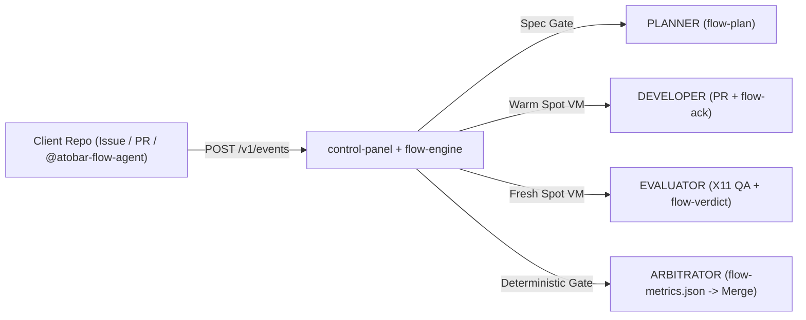

# atobar-flow — Agentic Teams On BYOK And Repos (ATOBAR)

`atobar-flow` (**ATOBAR** — **Agentic Teams On BYOK And Repos**) is a multi-tenant, GitHub-native software factory. Co-founders and collaborators share their own LLM API keys (BYOK), write GitHub Issues, and let isolated AI roles (`PLANNER`, `DEVELOPER`, `EVALUATOR`, `ARBITRATOR`) plan, code, visually verify, and merge changes in *Client Repos* (tenants).

All factory logic lives in this 5-package monorepo (`contracts`, `flow-engine`, `control-panel`, `flow-agent`, `atobar-ops`). Client repos stay clean and portable: they hold only `.github/workflows/flow-trigger.yml` and `flow-metrics.yml`.

- **Product Requirements (`PRD`):** [`docs/PRD.md`](docs/PRD.md)
- **High-Level Design (`HLD`):** [`docs/HLD.md`](docs/HLD.md)
- **Swarm Protocol & Failure Modes:** [`docs/SWARM_ARCHITECTURE.md`](docs/SWARM_ARCHITECTURE.md)
- **Client Repo Onboarding:** [`docs/ONBOARDING.md`](docs/ONBOARDING.md)
- **Roadmap & As-Built Status:** [`docs/ROADMAP.md`](docs/ROADMAP.md)



## How the factory loop works

1. **Trigger & Spec Gate (`J38`, `J49`).** Applying `flow:feature`, `flow:fix`, or `flow:plan`—or commenting `@atobar-flow-agent` on an Issue or PR—sends an event to `control-panel` -> `flow-engine`. Concrete specs go straight to `DEVELOPER`; broad issues go to `PLANNER`, which posts a `flow-plan` checklist and waits for `flow:approved` (or `@atobar-flow-agent approve`).
2. **DEVELOPER (`flow-agent/src/flow_agent/roles/developer/`).** Runs in an isolated EC2 Spot worktree (`nanobot` SDK + stdio MCP tools in `flow-agent/src/flow_agent/tools_mcp/`), writes tests first, implements the change, opens a PR, and posts a `flow-ack` comment.
3. **EVALUATOR (`flow-agent/src/flow_agent/roles/evaluator/`).** Runs on a separate, fresh Spot VM (`contents: read` token). It checks out exact `head_sha`, waits for GitHub Actions CI, runs Stage 1 static `file:#L` checks (`J39`) and Stage 2 X11/Playwright visual verification with `xwininfo`/process proof (`J49`), and posts `flow-verdict` + `flow/eval`.
4. **Loop & Plain-English Steering (`J49`).** `DEVELOPER` fixes findings or disputes them. Humans can steer any PR by commenting `@atobar-flow-agent <instructions>`. The deterministic `CONDUCTOR` escalates to a human if cost, round, wall-clock, or repeat-finding caps trip.
5. **ARBITRATOR & Living Wiki (`J50`).** When CI is green, `flow-verdict` is `approved`, and disputes are empty on `head_sha`, `ARBITRATOR` verifies `flow-metrics.json` provenance from GitHub Actions and runs `arbitrate()` (zero LLM). Passing PRs are recorded (`shadow`), recommended (`recommend`), or merged (`auto_merge`), and `SotaWiki` queues a coalesced Mermaid architecture refresh.

## Onboarding a Client Repo

Install the `atobar-flow-agent` GitHub App, add the repo in the Control Panel (`<CP_PUBLIC_URL>`), upload your BYOK keys, and run inside a clone of your repo:

```bash
curl -fsSL https://raw.githubusercontent.com/atobar-flow/atobar-flow/main/scripts/onboard.sh | bash
```

See [`docs/ONBOARDING.md`](docs/ONBOARDING.md) for the 8-stage setup, metric compilation, and `@atobar-flow-agent` commands.

## AI Agent Guidelines

Autonomous coding agents (`pi`, Claude Code, Devin, Gemini) working **on** this repository must follow root [`AGENTS.md`](AGENTS.md) and [`docs/AGENTS.md`](docs/AGENTS.md).
