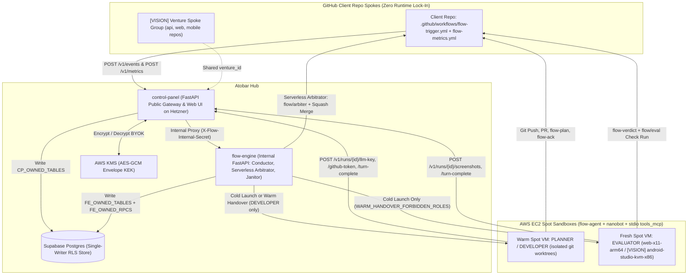
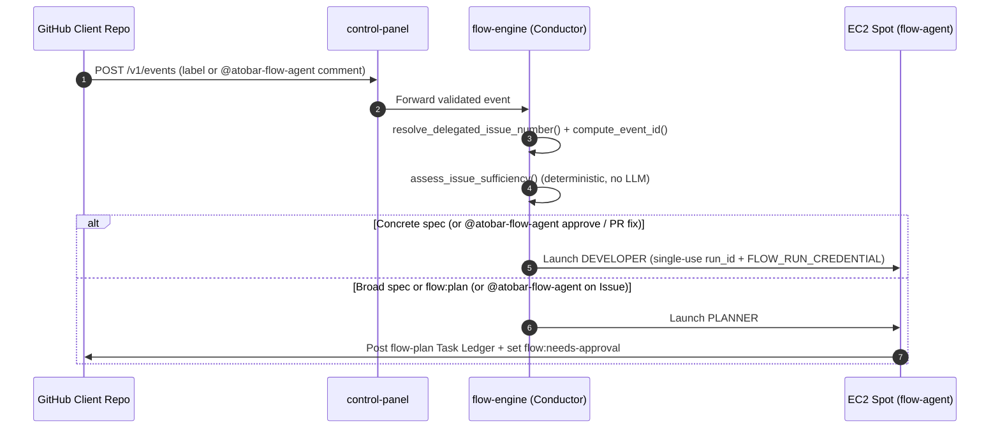
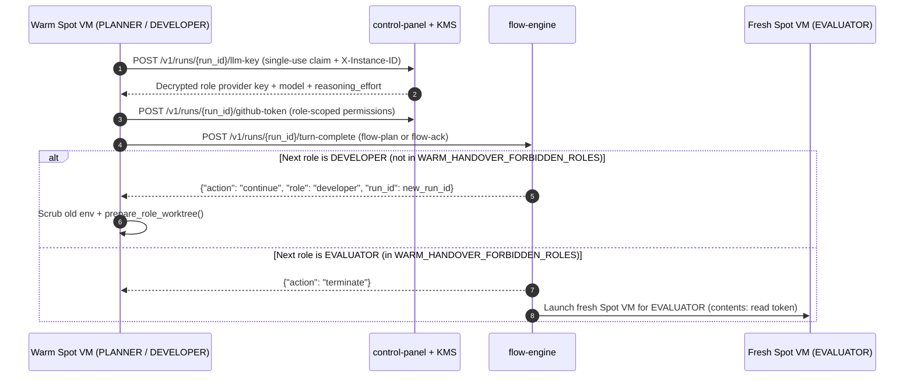
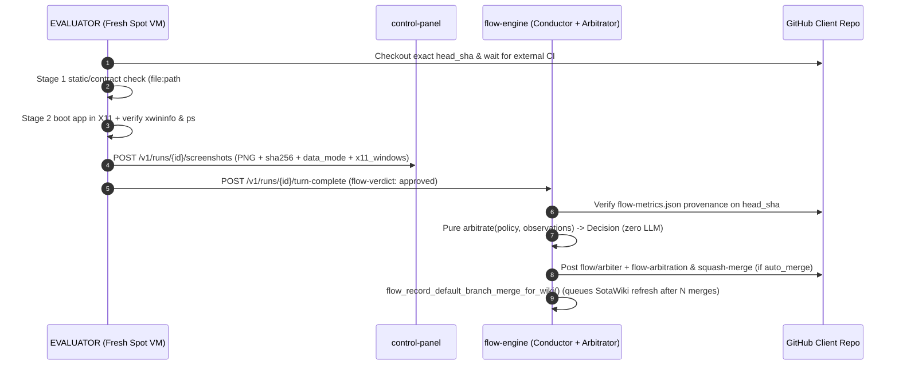
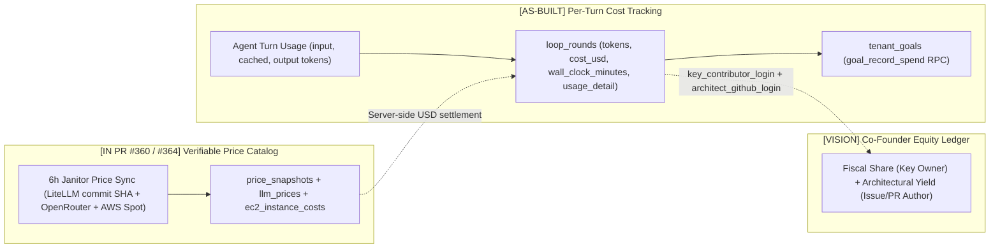
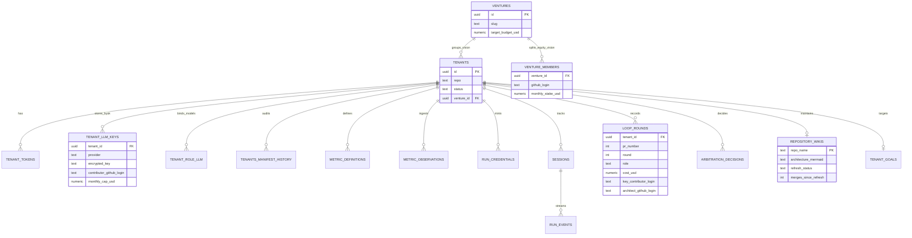

# High-Level Design (HLD) — atobar-flow (Agentic Teams On BYOK And Repos)

This High-Level Design for **ATOBAR** (**Agentic Teams On BYOK And Repos**) is derived directly from [`docs/PRD.md`](PRD.md). It documents the 5-package monorepo (`contracts`, `flow-engine`, `control-panel`, `flow-agent`, `atobar-ops`), runtime sequences, single-writer database ownership, and the 3 `[VISION]` blueprints.

---

## 1. System Context & Hub-and-Spoke Topology

`atobar-flow` runs as a central **Hub** (`control-panel` + `flow-engine` + Supabase + AWS KMS) connected to lightweight **GitHub Client Repo Spokes** and isolated **AWS EC2 Spot Sandboxes** (`flow-agent`).



### 1.1 Monorepo Package Responsibilities

| Package | Path | Responsibility | LLM Imports Allowed? |
| :--- | :--- | :--- | :--- |
| `atobar_contracts` | `contracts/src/atobar_contracts/` | Schemas (`manifest.py`, `goal.py`, `envelopes.py`, `wiki.py`), pure `step()` state machine (`machine.py`), pure `arbitrate()` gate (`arbitration.py`), `conductor_io.py`, Spot launcher (`github_rest.py`). | **No** (enforced by `tests/test_boundaries.py`) |
| `flow_engine` | `flow-engine/src/flow_engine/` | Internal FastAPI service (`api.py`), single-writer `SupabaseStore` (`store.py`), Spec-Sufficiency Gate (`conductor/sufficiency.py`), outer goal loop (`conductor/goal.py`), GC/reaper (`conductor/gc.py`). | **No** (enforced by `tests/test_boundaries.py`) |
| `control_panel` | `control-panel/src/control_panel/` | Public FastAPI gateway & UI (`app.py`, `web.py`), KMS `AES-GCM` vault (`llm_keys.py`), OIDC/token auth (`oidc.py`, `tokens.py`), encrypted screenshot storage. | **No** |
| `flow_agent` | `flow-agent/src/flow_agent/` | Spot sandbox runner (`main.py`), roles (`planner`, `developer`, `evaluator`, `arbitrator`, `onboarder`, `metric_compiler`), `nanobot` runtime (`agents/`), stdio MCP server (`tools_mcp/`). | **Yes** |
| `atobar_ops` | `atobar-ops/src/atobar_ops/` | Operator & harness CLI (`verify`, `ship`, `review`, `watch`, `rerun`, `ssm`, `db`, `cp`, `ci`, `jumbo`, `labels`, `sessions`). | **No** |

---

## 2. Core Runtime Sequences (`[AS-BUILT @ J50]`)

### 2.1 Sequence 1 — Ingress, PR-to-Issue Resolution & Spec-Sufficiency Gate (`J38`, `J49`)

When a label (`flow:feature`, `flow:fix`, `flow:plan`, `flow:approved`, `flow:resume`) or `@atobar-flow-agent` comment arrives from GitHub, `flow-engine` resolves PR events back to their parent Issue number (`resolve_delegated_issue_number`) and runs `assess_issue_sufficiency()` (zero LLM).



### 2.2 Sequence 2 — Warm Developer Handover vs. Fresh Evaluator Boundary (`J38`, `J42`, `J43`)

`PLANNER -> DEVELOPER` (and `EVALUATOR -> DEVELOPER` rework) can continue on the same warm Spot VM inside a fresh `git worktree`. However, `WARM_HANDOVER_FORBIDDEN_ROLES = {"evaluator", "arbitrator"}` (`contracts/src/atobar_contracts/conductor_io.py`) guarantees that `EVALUATOR` never runs on a VM where `DEVELOPER` had shell access.



### 2.3 Sequence 3 — Two-Stage Evaluator, Serverless Arbitrator & Living Wiki (`J39`, `J49`, `J50`)



### 2.4 Sequence 4 — Turn Spend, Verifiable Price Catalog (`J48`) & Equity Settlement (`[VISION]`)



---

## 3. Data Architecture & Single-Writer Ownership

Table and RPC write ownership is strictly partitioned between `control-panel` and `flow-engine` and enforced at CI time by `tests/test_table_ownership.py`.



### 3.1 Single-Writer Table Ownership Matrix (`tests/test_table_ownership.py`)

| Writer Service | Owned Tables / RPCs | Purpose |
| :--- | :--- | :--- |
| **`control-panel`** (`CP_OWNED_TABLES`) | `tenant_tokens` | SHA-256 hashed `atb_...` client tokens. |
| **`control-panel`** (`CP_OWNED_TABLES`) | `tenant_llm_keys` | KMS `AES-GCM` encrypted BYOK keys with `(tenant_id, provider)` AAD. |
| **`control-panel`** (`CP_OWNED_TABLES`) | `tenant_role_llm` | Per-role `(provider, model, reasoning_effort)` bindings. |
| **`control-panel`** (`CP_OWNED_TABLES`) | `security_audit_log` | Append-only audit log for key/token/admin mutations. |
| **`flow-engine`** (`FE_OWNED_TABLES`) | `tenants`, `tenants_manifest_history` | Tenant lifecycle state, manifest JSON, and immutable manifest audit history. |
| **`flow-engine`** (`FE_OWNED_TABLES`) | `metric_definitions`, `metric_definitions_history`, `metric_observations` | Compiled metric specs, history, and append-only CI metric observations. |
| **`flow-engine`** (`FE_OWNED_TABLES`) | `run_credentials` | Single-run token hashes, `instance_id` binding, `llm_key_claimed`, and `envelope_comment_id`. |
| **`flow-engine`** (`FE_OWNED_TABLES`) | `sessions`, `session_events`, `run_events` | Live Spot instance heartbeats and append-only `run_events` telemetry stream. |
| **`flow-engine`** (`FE_OWNED_TABLES`) | `loop_rounds`, `conductor_events`, `arbitration_decisions` | Per-turn token/cost ledger, webhook deduplication, and metric gate decisions. |
| **`flow-engine`** (`FE_OWNED_TABLES`) | `repository_wikis` | `SotaWiki` content (`architecture_mermaid`) and coalesced refresh queue state (`J50`). |
| **`flow-engine`** (`FE_OWNED_TABLES`) | `tenant_goals` | Outer-loop target state, budgets, and stall counters (`goal_step()`). |
| **`flow-engine`** (`FE_OWNED_RPCS`) | `approve_metric`, `flow_claim_wiki_refresh`, `flow_complete_wiki_refresh_run`, `flow_record_default_branch_merge_for_wiki`, `flow_update_wiki_policy`, `flow_upsert_wiki_content`, `goal_record_spend`, `goal_record_merge` | Atomic Postgres state transitions and counter increments. |

---

## 4. Blueprints for the 3 `[VISION]` Extensions

### 4.1 Granular BYOK Key Routing (Per-Repo, Per-Role -> Per-Invoking-User) & Equity Ledger (`FR-5`, `[VISION]`)

- **As-Built Today (`[AS-BUILT]`):** Costs are shared and routed on a **per-repo, per-role** level via `tenant_llm_keys (tenant_id, provider)` and `tenant_role_llm (tenant_id, role -> provider, model, reasoning_effort)`.
- **Roadmap Extension (`[VISION]`):**
  - Add `ventures (id, slug, name, lifecycle_stage, target_budget_usd, created_at)` and `venture_members (venture_id, github_login, monthly_stake_usd, joined_at)`.
  - Extend `tenant_llm_keys` with nullable `contributor_github_login text` and `monthly_cap_usd numeric` so keys can be scoped either to a **specific invoking GitHub user** (who applied the `flow:*` label or posted `@atobar-flow-agent`) or to a shared co-founder pool.
  - When `POST /v1/runs/{run_id}/llm-key` resolves credentials for a run, it selects the invoking user's key first (if configured and under `monthly_cap_usd`) and falls back to the repo's shared per-role key pool.
  - Extend `loop_rounds` with `key_contributor_login text` (whose BYOK key funded the turn) and `architect_github_login text` (who authored the Jumbo Issue, spec, or `@atobar-flow-agent` PR steer).
- **Deterministic Attribution Formulas (No LLM):**
  ```text
  Fiscal_Share(founder_i) =
      sum(LLM_Cost_USD(founder_i) + Spot_Compute_Cost_USD(founder_i))
      / sum(Total_Venture_Cost_USD)

  Architectural_Yield(founder_i) =
      count(Merged_PRs_and_Goal_Progress attributed to founder_i Jumbo Issues, Specs, and PR Steers)
      / count(Total_Merged_Venture_PRs)
  ```

### 4.2 Multi-Repo Venture Spoke Graph (`FR-7`, `[VISION]`)

- **Schema Delta:**
  - Add nullable `venture_id uuid references ventures(id)` on `tenants` so `api`, `web`, and `mobile` client repos belong to one Venture.
  - Add `venture_jumbo_links (venture_id, parent_repo, parent_issue, child_repo, child_issue, status)` so a Venture Jumbo Issue tracks child spoke issues across repositories.
- **Isolation Rule:** Each client repo keeps its own `run_credentials`, role-scoped GitHub token, and `.github/workflows/flow-trigger.yml`. Cross-repo coordination happens only through GitHub Issue links and `SotaWiki` contracts—preserving 1-commit exit for every repo.

### 4.3 Pluggable Spot Runtime Image Profiles (`FR-4`, `[VISION]`)

- **Manifest Contract (`contracts/src/atobar_contracts/manifest.py`):**
  ```python
  MachineImageProfile = Literal[
      "web-x11-arm64",          # Default: t4g.large ARM64 with Xvfb, Fluxbox, Chromium/Playwright, xwininfo
      "android-studio-kvm-x86", # Mobile QA: c7i.large / g5.xlarge x86_64 KVM with Android SDK, headless Emulator & ADB
      "fullstack-compose",      # Multi-container QA: t4g.xlarge with Docker Compose + X11
  ]
  ```
- **Dispatcher Mapping (`flow-engine/src/flow_engine/conductor/dispatch.py`):**
  - `web-x11-arm64` (`[AS-BUILT]` default): launches `t4g.large` from the standard Packer AMI.
  - `android-studio-kvm-x86` (`[VISION]`): launches a KVM-enabled x86 instance (`c7i.large` or `g5.xlarge`) pre-baked with Android SDK, `emulator -no-window -gpu swiftshader_indirect`, and ADB tools so `EVALUATOR` installs the APK, runs UIAutomator journeys, and uploads native mobile screenshots with ADB process attestation.

---

## 5. PRD-to-HLD Traceability Matrix

| Requirement | Status | Primary Modules & Endpoints | Database Tables / RPCs | Verification Tests |
| :--- | :--- | :--- | :--- | :--- |
| **FR-1** (GitHub Hub & Spoke Ingress) | `[AS-BUILT]` | `control-panel/src/control_panel/app.py` (`POST /v1/events`, `POST /v1/metrics`), `client_templates.py` | `tenants`, `tenant_tokens`, `conductor_events` | `control-panel/tests/`, `flow-engine/tests/test_service_cutover_j34.py` |
| **FR-2** (4-Role Swarm & Warm Handover) | `[AS-BUILT]` | `contracts/src/atobar_contracts/conductor_io.py`, `flow-engine/src/flow_engine/api.py` (`POST /runs/{id}/turn-complete`), `flow-agent/src/flow_agent/runtime/sandbox.py` | `run_credentials`, `sessions`, `loop_rounds` | `flow-engine/tests/test_turn_complete_handover.py` |
| **FR-3** (Deterministic Conductor & Caps) | `[AS-BUILT]` | `contracts/src/atobar_contracts/machine.py` (`step()`), `contracts/src/atobar_contracts/envelopes.py`, `flow-engine/src/flow_engine/conductor/goal.py` | `loop_rounds`, `tenant_goals`, `goal_record_spend`, `goal_record_merge` | `tests/test_boundaries.py` |
| **FR-4** (Visual QA & Spot Image Profiles) | `[AS-BUILT]` Web / `[VISION]` Mobile | `flow-agent/src/flow_agent/roles/evaluator/spec.py`, `flow-agent/src/flow_agent/tools/vision_tools.py`, `control-panel/src/control_panel/app.py` (`POST /v1/runs/{id}/screenshots`) | `run_events` | `flow-agent/tests/roles/test_evaluator_two_stage.py`, `flow-agent/tests/tools/test_vision_provenance.py` |
| **FR-5** (BYOK Vault, Pricing & Equity) | `[AS-BUILT]` / `[IN PR #360]` / `[VISION]` | `control-panel/src/control_panel/llm_keys.py`, `flow-agent/src/flow_agent/runtime/key_delivery.py`, `flow-agent/src/flow_agent/runtime/pricing.py` | `tenant_llm_keys`, `tenant_role_llm`, `loop_rounds` (`+ ventures`, `venture_members`) | `control-panel/tests/test_llm_keys.py` |
| **FR-6** (Living `SotaWiki` Mermaid) | `[AS-BUILT]` | `contracts/src/atobar_contracts/wiki.py` (`validate_mermaid_diagram`), `flow-agent/src/flow_agent/knowledge/onboard_repo.py` | `repository_wikis`, `flow_claim_wiki_refresh`, `flow_upsert_wiki_content` | `flow-agent/tests/knowledge/test_onboard_repo.py`, `flow-engine/tests/test_wiki_sql_migration.py` |
| **FR-7** (Multi-Repo Venture Spokes) | `[VISION]` | HLD §4.2 (`tenants.venture_id`, cross-repo Jumbo Issue links) | `ventures`, `venture_jumbo_links` | `tests/test_boundaries.py` |
| **NFR-1** (Zero-Trust Sandbox Isolation) | `[AS-BUILT]` | `flow-agent/src/flow_agent/core/untrusted.py`, `flow-agent/src/flow_agent/agents/nanobot_config.py`, `flow-agent/src/flow_agent/tools_mcp/server.py` | `run_credentials`, `security_audit_log` | `tests/test_boundaries.py` |
| **NFR-2** (Single-Writer DB Ownership) | `[AS-BUILT]` | `control-panel/src/control_panel/store.py`, `flow-engine/src/flow_engine/store.py` | `CP_OWNED_TABLES`, `FE_OWNED_TABLES`, `FE_OWNED_RPCS` | `tests/test_table_ownership.py` |
| **NFR-3** (Zero LLM in Deterministic Layers) | `[AS-BUILT]` | `contracts/src/atobar_contracts/`, `flow-engine/src/flow_engine/` | — | `tests/test_boundaries.py` |
| **NFR-4** (1-Commit Client Repo Exit) | `[AS-BUILT]` | `.github/workflows/flow-trigger.yml`, `.github/workflows/flow-metrics.yml` | — | `docs/ONBOARDING.md` |
