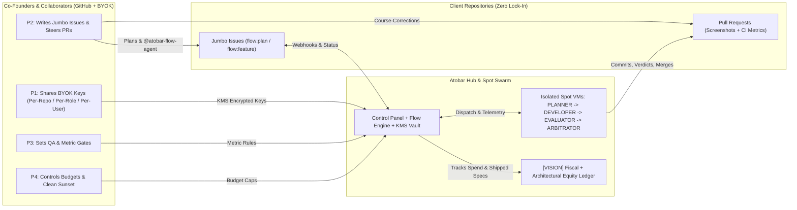

# Product Requirements Document (PRD) — atobar-flow (Agentic Teams On BYOK And Repos)

`atobar-flow` (**ATOBAR** — **Agentic Teams On BYOK And Repos**) is a Hub-and-Spoke software factory built around GitHub. Co-founders and collaborators share their own LLM API keys (BYOK), plan work through GitHub Issues, and let isolated AI roles (`PLANNER`, `DEVELOPER`, `EVALUATOR`, `ARBITRATOR`) write, test, visually verify, and merge code across client repositories.

> **Status tags used in this document:**
> - `[AS-BUILT]` — Live on `main` (through `J50`).
> - `[IN PR]` — Open implementation PR (`J48` `#360` / `#364` verifiable price catalog).
> - `[VISION]` — Planned multi-founder / multi-repo extension for the value-chain roadmap.

---

## 1. Vision & BYOK Cost Routing

### 1.1 Why Atobar Exists
1. **Shared BYOK & Per-Repo, Per-Role Routing (`[AS-BUILT]` + `[VISION]`):** Co-founders and teams bring their own LLM API keys (BYOK) to build multi-repo products together. Today (`[AS-BUILT]`), teams share costs and route keys and models on a **per-repo, per-role** level (`tenant_llm_keys` + `tenant_role_llm`: e.g. assigning different providers and models to `planner`, `developer`, and `evaluator` per repository). More granular key management—such as **per-invoking-user** key routing and pooled co-founder budgets—is on the roadmap (`[VISION]`, tracked in [`docs/ROADMAP.md`](ROADMAP.md)).
2. **Fair Equity Split Among Collaborators:** Because AI writes the boilerplate, contributor value comes from two measurable inputs:
   - **Fiscal capital:** LLM tokens and AWS Spot compute paid by that contributor's keys.
   - **Architectural capital:** Jumbo Issues, metric specs, and PR course-corrections authored by that contributor that ship working features.
3. **GitHub Is the Only Workspace:** Humans coordinate with each other and with agents strictly through **Jumbo Issues** (planning) and **Pull Requests** (code, visual proof, and CI metric checks).
4. **Unattended Visual & Mobile QA:** Every PR is verified by an independent `EVALUATOR` on a separate Spot VM—capturing live X11/Playwright screenshots today (`[AS-BUILT]`) and booting headless **Android Studio / KVM emulators** for native mobile apps next (`[VISION]`).
5. **Zero Lock-In Lifecycle:** Atobar is a thin Hub-and-Spoke wrapper around GitHub. Client repos contain only `.github/workflows/flow-trigger.yml` and `flow-metrics.yml`. Deleting those two files detaches the repo cleanly in one commit.

---

## 2. Target Personas & Anti-Goals

### 2.1 User Personas (`P1`–`P4`)

| ID | Persona | Role in the Venture | What They Need from Atobar |
| :--- | :--- | :--- | :--- |
| **P1** | **Token-Staking Co-Founder** | Shares BYOK API keys across repositories, roles, or invoking users. | KMS `AES-GCM` encrypted key storage, per-repo and per-role model routing (`[AS-BUILT]`), per-invoking-user key routing (`[VISION]`), and an audit trail of token/compute spend vs. shipped work. |
| **P2** | **Swarm Wrangler** | Breaks product architecture into Jumbo Issues and steers active agent runs. | GitHub-native workflow: apply `flow:plan` or `flow:feature`, review the `flow-plan` checklist, and steer PRs with `@atobar-flow-agent` comments. |
| **P3** | **QA Gatekeeper** | Owns release quality across web, API, and mobile repos. | An isolated `EVALUATOR` VM (`contents: read` token) that boots the real app, proves window/process state via screenshots, and a deterministic `ARBITRATOR` that checks CI metrics before merge. |
| **P4** | **FinOps & Sunset Steward** | Manages per-PR and per-goal budgets and runs clean repo handoff or sunset. | Hard per-PR and per-goal cost/stall circuit breakers, verifiable token + Spot compute pricing, and zero runtime lock-in inside client repos. |

### 2.2 Explicit Anti-Goals
- **No custom IDE or chat app:** All human planning and code review happen in GitHub Issues and PRs.
- **No Atobar SDK inside client repos:** Client repos never import `atobar-flow` packages at runtime.
- **No LLM in merge or budget decisions:** State transitions, circuit breakers, and metric pass/fail checks are 100% deterministic Python.

---

## 3. End-to-End User Journeys (`J1`–`J6`)

### J1 — Repo Onboarding & Pooled BYOK Staking (~5 Minutes)
| Step | Status | Action |
| :--- | :--- | :--- |
| **J1.1** | `[AS-BUILT]` | Co-founder signs into Control Panel via GitHub OAuth, installs the `atobar-flow-agent` GitHub App on the client repo, and runs `curl -fsSL .../onboard.sh \| bash`. |
| **J1.2** | `[AS-BUILT]` | Co-founder saves BYOK keys (`gemini`, `claude`, `openai`, `deepseek`, `grok`) encrypted with AWS KMS (`AES-GCM`) and routes models on a per-repo, per-role level (`tenant_role_llm`). |
| **J1.3** | `[VISION]` | Collaborators attach per-invoking-user or pooled co-founder provider keys with optional spend caps (`contributor_github_login`, `monthly_cap_usd`). |
| **J1.4** | `[AS-BUILT]` | The `onboarder` Spot role generates the initial `SotaWiki` (including a validated Mermaid architecture diagram, `J50`) and opens the PR adding `.github/workflows/flow-trigger.yml` and `flow-metrics.yml`. |

### J2 — Jumbo Issue Planning & Spec-Sufficiency Gate
| Step | Status | Action |
| :--- | :--- | :--- |
| **J2.1** | `[AS-BUILT]` | Co-founder configures repository Target Metrics, Guardrails, and Goal Budgets (`tenant_goals`) and opens a GitHub Issue. |
| **J2.2** | `[AS-BUILT]` | When labeled `flow:feature` / `flow:plan` (or mentioned via `@atobar-flow-agent`), the deterministic Spec-Sufficiency Gate (`J38`) checks if the issue has concrete file targets and acceptance criteria. Well-specified issues go straight to `DEVELOPER`; broad issues go to `PLANNER`, which posts a `flow-plan` Task Ledger and pauses at `flow:needs-approval`. |
| **J2.3** | `[VISION]` | A Venture-level Jumbo Issue links child spoke issues across `api`, `web`, and `mobile` client repos (`venture_jumbo_links`). |

### J3 — Long-Running Execution, Warm Handover & PR Steering
| Step | Status | Action |
| :--- | :--- | :--- |
| **J3.1** | `[AS-BUILT]` | On approval (`flow:approved` or `@atobar-flow-agent approve`), `CONDUCTOR` launches an EC2 Spot VM. `PLANNER -> DEVELOPER` and rework turns reuse the warm Spot VM in isolated `git worktree` directories via `POST /v1/runs/{run_id}/turn-complete` (`J38`). |
| **J3.2** | `[AS-BUILT]` | Verifying roles (`EVALUATOR`, `ARBITRATOR`) never accept a warm handover from `DEVELOPER` (`WARM_HANDOVER_FORBIDDEN_ROLES`, `J43`); `EVALUATOR` always runs on a fresh Spot VM. |
| **J3.3** | `[AS-BUILT]` | Live tool calls, heartbeats, and USD spend stream into the pinned GitHub telemetry comment. Co-founders steer active or escalated PRs using `@atobar-flow-agent` comments (`J49`). |

### J4 — Unattended Visual & Mobile QA
| Step | Status | Action |
| :--- | :--- | :--- |
| **J4.1** | `[AS-BUILT]` | `EVALUATOR` checks out exact `head_sha`, waits for external GitHub Actions CI, and runs Stage 1 static/contract checks (`file:<path>#L<start>-L<end>`, `J39`). |
| **J4.2** | `[AS-BUILT]` | In Stage 2, `EVALUATOR` starts the app inside X11, records active windows (`xwininfo`) and OS processes (`ps`), uploads encrypted screenshots tagged with `data_mode` (`live` \| `synthetic` \| `hybrid`) (`J49`), and posts `flow-verdict` + `flow/eval`. |
| **J4.3** | `[VISION]` | When a repo sets `machine_image_profile: android-studio-kvm-x86`, `flow-engine` boots a KVM Spot AMI with headless Android Emulator + ADB so `EVALUATOR` captures native mobile screenshots. |

### J5 — Deterministic Metric Gate, Cost Settlement & Auto-Merge
| Step | Status | Action |
| :--- | :--- | :--- |
| **J5.1** | `[AS-BUILT]` | Once CI is green, `flow-verdict` is `approved`, and `flow-ack` has no open disputes on `head_sha`, `ARBITRATOR` verifies `flow-metrics.json` provenance from GitHub Actions and runs `arbitrate()` (zero LLM). |
| **J5.2** | `[AS-BUILT]` | Based on `arbitration.mode` (`shadow` -> `recommend` -> `auto_merge`), the PR is recorded, recommended, or squash-merged, and `repository_wikis` queues a coalesced Mermaid `SotaWiki` refresh after N merges (`J50`). |
| **J5.3** | `[AS-BUILT + IN PR + VISION]` | `flow-engine` records turn spend in `loop_rounds.cost_usd` and `tenant_goals.spent_usd` (`[AS-BUILT]`), settles LLM + EC2 Spot compute against pinned price snapshots (`[IN PR: J48 #360]`), and credits the co-founder fiscal/architectural ledger (`[VISION]`). |

### J6 — Goal Completion, Harvest & Zero-Lock-In Sunset
| Step | Status | Action |
| :--- | :--- | :--- |
| **J6.1** | `[AS-BUILT]` | After each merge, `goal_step()` re-evaluates default-branch metrics. When all target metrics pass, the goal moves to `met` and guardrails prevent regressions on future PRs. |
| **J6.2** | `[AS-BUILT + VISION]` | Co-founders export the final Contribution Ledger (`[VISION]`) and sunset or hand off any client repo by deleting `.github/workflows/flow-trigger.yml` and `flow-metrics.yml` (`[AS-BUILT]`). |

---

## 4. Functional & Non-Functional Requirements

### 4.1 Functional Requirements (`FR-1`..`FR-7`)

| ID | Requirement | Status | Summary |
| :--- | :--- | :--- | :--- |
| **FR-1** | **Bare-Bones GitHub Hub & Spoke Ingress** | `[AS-BUILT]` | Client repos hold only `flow-trigger.yml` and `flow-metrics.yml`. All webhooks and OIDC/Bearer events enter via `POST /v1/events` and `POST /v1/metrics`. |
| **FR-2** | **4-Role Loop & Warm Developer Handover** | `[AS-BUILT]` | `PLANNER`, `DEVELOPER`, `EVALUATOR`, and `ARBITRATOR` coordinate through GitHub comments. `DEVELOPER` can reuse a warm Spot VM across turns (`J38`); `EVALUATOR` always runs on a fresh Spot VM (`J43`). |
| **FR-3** | **Deterministic Conductor & Circuit Breakers** | `[AS-BUILT]` | Pure `step()` state machine (`contracts/src/atobar_contracts/machine.py`) enforces `max_review_rounds`, `max_repeat_finding`, `max_pr_cost_usd`, `max_pr_wall_clock_minutes`, and `tenant_goals` budgets without calling an LLM. |
| **FR-4** | **Unattended Visual QA & Spot Image Profiles** | `[AS-BUILT]` Web X11 / `[VISION]` Mobile KVM | Stage 1 static `file:#L` check + Stage 2 X11 screenshot capture with `xwininfo`/`ps` proof (`J39`, `J49`). `[VISION]` adds per-repo `machine_image_profile` (`web-x11-arm64`, `android-studio-kvm-x86`, `fullstack-compose`). |
| **FR-5** | **KMS BYOK Vault, Per-Repo/Per-Role Routing & Granular Key Management** | `[AS-BUILT]` Per-Repo/Per-Role BYOK + Turn Cost / `[IN PR]` J48 / `[VISION]` Per-Invoking-User & Equity Ledger | KMS `AES-GCM` keys with `(tenant_id, provider)` AAD, per-repo and per-role model routing (`tenant_role_llm`), single-use `/llm-key` delivery, and per-turn cost in `loop_rounds` (`[AS-BUILT]`); janitor price snapshots + Spot cost (`[IN PR #360]`); per-invoking-user key routing and co-founder Fiscal + Architectural equity attribution (`[VISION]`). |
| **FR-6** | **Living Architecture Wiki (`SotaWiki`)** | `[AS-BUILT]` | `onboarder` synthesizes structured repo knowledge with a validated Mermaid diagram (`validate_mermaid_diagram`) and auto-refreshes it after N default-branch merges (`J50`). |
| **FR-7** | **Multi-Repo Venture Grouping** | `[VISION]` | Group multiple microservice `tenants` under one `venture_id` and track cross-repo Jumbo Issue dependencies (`venture_jumbo_links`). |

### 4.2 Non-Functional Requirements (`NFR-1`..`NFR-4`)

| ID | Requirement | Status | Rule |
| :--- | :--- | :--- | :--- |
| **NFR-1** | **Zero-Trust Sandbox Isolation** | `[AS-BUILT]` | Spot VMs hold zero database keys, authenticate via single-run `FLOW_RUN_CREDENTIAL` + `X-Instance-ID`, receive role-scoped GitHub tokens (`contents: read` for `EVALUATOR`), and wrap all GitHub text in `<untrusted_content>` delimiters (`J42`–`J44`). |
| **NFR-2** | **Single-Writer Table Ownership** | `[AS-BUILT]` | `control-panel` writes only `CP_OWNED_TABLES`; `flow-engine` writes only `FE_OWNED_TABLES` and `FE_OWNED_RPCS` (enforced by `tests/test_table_ownership.py`). |
| **NFR-3** | **Deterministic Control & Arbitration** | `[AS-BUILT]` | `atobar_contracts` and `flow_engine` never import LLM SDKs (enforced by `tests/test_boundaries.py`). |
| **NFR-4** | **1-Commit Client Repo Exit** | `[AS-BUILT]` | Deleting `.github/workflows/flow-trigger.yml` and `flow-metrics.yml` completely disconnects a client repo with zero broken imports or runtime dependencies. |

---

## 5. `https://github.com/atobar-flow` Scrollytelling Storyboard (7 Scenes)

This storyboard defines the 7 visual scenes for the `https://github.com/atobar-flow` narrative experience.

| Scene | Title | Persona | Visual / Diagram Beat | Status Badge |
| :--- | :--- | :--- | :--- | :--- |
| **Scene 1** | **Shared BYOK & Per-Role / Per-User Routing** | `P1` Token-Staking Co-Founder | Co-founders deposit KMS-encrypted BYOK keys into the Atobar Hub, routing costs per repo and per role today (`[AS-BUILT]`) and per invoking GitHub user on the roadmap (`[VISION]`). | `[AS-BUILT]` Per-Repo/Role / `[VISION]` Per-User |
| **Scene 2** | **Architecture by Jumbo Issue** | `P2` Swarm Wrangler | A Jumbo Issue enters `POST /v1/events`. Spec-Sufficiency Gate (`J38`) routes either to `PLANNER` (posting a `flow-plan` grounded in the repo's Mermaid `SotaWiki`) or straight to `DEVELOPER`. | `[AS-BUILT]` Single Repo / `[VISION]` Multi-Repo |
| **Scene 3** | **Warm Worktrees & Plain-English Steering** | `P2` Swarm Wrangler | `PLANNER -> DEVELOPER` hands over on a warm Spot VM using isolated `git worktree` checkouts while streaming live telemetry. Co-founders course-correct PRs with `@atobar-flow-agent`. | `[AS-BUILT]` |
| **Scene 4** | **Unattended Visual & Mobile QA** | `P3` QA Gatekeeper | Fresh `EVALUATOR` Spot VM runs Stage 1 `file:#L` checks and Stage 2 visual proof: X11/Playwright screenshots with `xwininfo` attestation today, plus Android Studio KVM emulator screenshots for mobile apps. | `[AS-BUILT]` Web X11 / `[VISION]` Android KVM |
| **Scene 5** | **Deterministic Metric Gate & Living Wiki** | `P3` QA Gatekeeper | Pure `arbitrate()` verifies `flow-metrics.json` from GitHub Actions, squash-merges the PR (`auto_merge`), and triggers a coalesced Mermaid `SotaWiki` refresh (`J50`). | `[AS-BUILT]` |
| **Scene 6** | **Verifiable FinOps & Fair Equity Split** | `P1` & `P4` FinOps Steward | Server-side settlement combines LLM token spend and EC2 Spot compute with shipped Jumbo Issues/PRs to compute each founder's Fiscal Share and Architectural Yield. | `[AS-BUILT]` Turn Cost / `[IN PR]` J48 / `[VISION]` Equity Ledger |
| **Scene 7** | **Goal Harvest & Zero-Lock-In Sunset** | `P4` Sunset Steward | Once `tenant_goals` targets are met, guardrails protect the default branch, and removing `flow-trigger.yml` leaves a clean, standalone GitHub repo with zero lock-in. | `[AS-BUILT]` |
