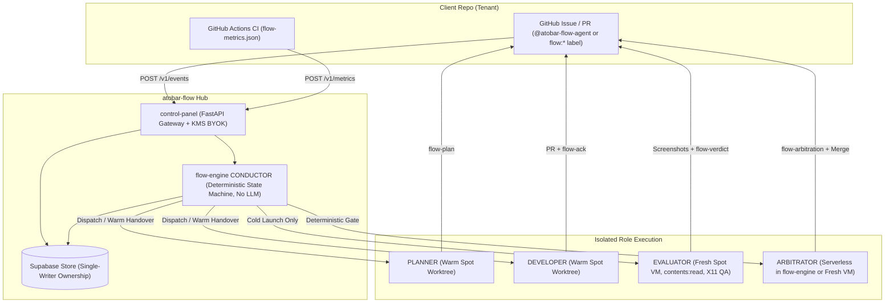
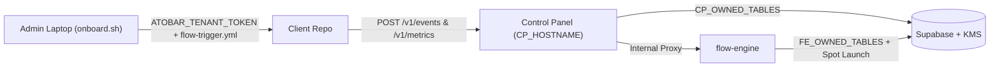

# Swarm Factory Architecture (ADR-11)

Status: **Built and live** across the 5-package monorepo (`contracts`, `flow-engine`, `control-panel`, `flow-agent`, `atobar-ops`). See [`docs/PRD.md`](PRD.md) for product requirements and [`docs/HLD.md`](HLD.md) for the full High-Level Design and `[VISION]` blueprints.

The onboarding control plane, KMS BYOK vault, deterministic `CONDUCTOR` (`flow-engine` + `contracts`), 4-role swarm (`PLANNER`, `DEVELOPER`, `EVALUATOR`, `ARBITRATOR`), outer goal loop (`conductor/goal.py`), `@atobar-flow-agent` conversational steering (`J49`), and `SotaWiki` Mermaid lifecycle (`J50`) are all implemented. Each role runs behind a pluggable `AgentRuntime` seam (`native` or `nanobot` with flow tools served by `tools_mcp` over stdio MCP).

`atobar-flow` (**ATOBAR** — **Agentic Teams On BYOK And Repos**) is a **multi-tenant, loop-based software factory**. Every Client Repo is a *tenant*. All factory logic lives in this repository; Client Repos hold only `.github/workflows/flow-trigger.yml` and `flow-metrics.yml`.

---

## 1. Topology



| Role | Kind | Reads | Writes | Never |
|---|---|---|---|---|
| **CONDUCTOR** | Deterministic code (`flow-engine` + `atobar_contracts.machine` / `conductor_io`) | GitHub events, `flow-*` envelopes, tenant policy | `loop_rounds`, labels, dispatches, escalations | Calls an LLM; edits code |
| **PLANNER** | LLM agent, isolated `git worktree` on warm Spot VM (`flow-agent/src/flow_agent/roles/planner/`) | Issue, `SotaWiki` (`/v1/runs/{id}/wiki`), `TenantManifest`, read-only repo search | `flow-plan` Task Ledger comment (`single_pr` vs `multi_issue_epic`) | Edits code; executes commands; opens PRs |
| **DEVELOPER** | LLM agent, isolated `git worktree` (`/home/ubuntu/worktrees/developer-<issue>`) | Issue, `SotaWiki`, `flow-plan`, repo, EVAL verdict envelopes | Branches `flow/issue-<issue>`, PRs, `flow-ack` comments | Merges; posts verdicts; reads EVAL transcripts |
| **EVALUATOR** | LLM agent, fresh detached `git worktree` at exact `head_sha`, separate model config | PR at exact `head_sha`, issue + `flow-plan` ACs, CI results, X11/CDP | `flow/eval` check run + `flow-verdict` comment | Pushes commits; edits files; reads DEV transcripts |
| **ARBITRATOR** | Deterministic gate (in-process serverless or warm Spot turn) | Tenant policy, verified `flow-metrics.json`, `metric_observations` | `flow/arbiter` check run, `flow-arbitration` comment, merge (if policy allows) | Lets an LLM decide pass/fail |
| **METRIC_COMPILER** | LLM proposal + deterministic dry-run on a default-branch worktree (`flow-agent/src/flow_agent/roles/metric_compiler/`), dispatched by the CP "Compile" button | Plain-language metric intent (`FLOW_METRIC_INTENT_B64`), README/file tree/deps, `SotaWiki` | `POST /v1/runs/{id}/metric-compilation` with the spec and the value **the runner measured** (credential-scrubbed env, `bash -o pipefail`, last stdout line); FE validates and stores it as `compiled` for human digest approval | Reports a model-claimed value; sees run/LLM/GitHub credentials in the dry-run; activates a metric |

---

## 2. Stigmergic Protocol (PR thread = append-only log)

Agents never talk to each other directly. They leave machine-readable **envelopes** in the PR thread; the CONDUCTOR reacts to them. Each envelope is a fenced block in a comment. It is valid **only if** the comment author is the bot identity bound to that role. Authorship is authenticated by GitHub, so a DEVELOPER cannot forge an EVAL verdict.

````
```flow-verdict
{"v":1,"role":"evaluator","tenant":"owner/repo","pr":42,"head_sha":"<40-hex>","round":2,
 "verdict":"changes_requested|approved","findings":[{"id":"F1","fingerprint":"sha256:…","severity":"blocker|major|minor","criterion":"AC-3","evidence":"check_run:123456|artifact:sha256:…"}]}
```
````

| Envelope | Author | Meaning |
|---|---|---|
| `flow-plan` | PLANNER | Outer-Loop Task Ledger (`complexity`, `goal`, `scope_files`, `out_of_scope`, `acceptance_criteria`, `implementation_steps`) |
| `flow-ack` | DEVELOPER | "`head_sha` addresses findings [F1,F2]; ready for review" or `"dispute":[{"id":"F3","reason":…}]` |
| `flow-verdict` | EVALUATOR | Verdict bound to one `head_sha` and one `round` |
| `flow-arbitration` | ARBITRATOR | Metric gate result with observation ids/digests, and the action taken |
| `flow-escalation` | CONDUCTOR | A circuit breaker tripped; a human now owns the PR |

**Spec-Sufficiency Gate & Warm Spot Handover (`J38`, `J43`).** At `flow:*` issue or `@atobar-flow-agent` ingress (`POST /v1/events`),
`assess_issue_sufficiency()` (`flow-engine/src/flow_engine/conductor/sufficiency.py`) deterministically inspects the issue body
and label (zero LLM imports): well-specified issues containing explicit scope/file anchors and acceptance criteria
fast-track straight to `DEVELOPER`, whereas `flow:plan` or broad issues route to `PLANNER` first. Across `PLANNER -> DEVELOPER`
and rework turns, a warm EC2 Spot VM (`flow-agent/src/flow_agent/main.py`) executes roles inside physically isolated `git worktree`
checkouts (`prepare_role_worktree()` in `flow-agent/src/flow_agent/runtime/sandbox.py`) and claims the next `DEVELOPER` turn
via `POST /v1/runs/{run_id}/turn-complete` while scrubbing prior LLM credentials. Verifying roles (`EVALUATOR`, `ARBITRATOR`)
are in `WARM_HANDOVER_FORBIDDEN_ROLES` (`contracts/src/atobar_contracts/conductor_io.py`, `J43` `#341`): `EVALUATOR` always runs on
a fresh Spot VM, and `ARBITRATOR` runs deterministically in-process in `flow-engine` (or on a fresh Spot VM).

**Agent runtimes (M09).** A role's LLM loop sits behind the `AgentRuntime` contract (`flow-agent/src/flow_agent/agents/`);
deterministic layers (conductor, protocol, tenancy) never see which runtime ran. `native` is the in-process
`llm_loop`; `nanobot` runs the role through the `nanobot-ai` Python SDK headless — the role's system prompt rides as
`SOUL.md`, and every flow tool (`create_and_verify_pr`, CI reads, X11/CDP screenshots, `todo_write`) is served by
`flow-agent/src/flow_agent/tools_mcp/` over stdio MCP with the same per-role allowlists enforced **server-side**.
`loop.agent_runtime` in the tenant manifest selects the runtime per repo; the `flow_run` payload propagates it to
`FLOW_AGENT_RUNTIME` on the spot instance, where `nanobot` installs via `uv sync --extra agents` at boot (no AMI
change). New agent runtimes plug in through the same seam and MCP server.

**Providers and keys.** Provider names are canonical in `flow-agent/src/flow_agent/llm/providers.py`
(`gemini|claude|deepseek|grok|openai`; aliases `anthropic`→`claude`, `xai`→`grok`, `google`→`gemini` are
normalized at the manifest boundary). Each role's provider, model and reasoning effort are set per repo in the Control Panel
("Model per role", stored in `tenant_role_llm`); nothing is hard-coded and there is no fallback model.
`POST /v1/runs/{run_id}/llm-key` returns the role's `provider`, `model` and `reasoning_effort` (409 when the role
is not configured) plus `keys: {provider: key}` for every provider any role uses — still one single-use fetch.
The model becomes `FLOW_ROLE_MODEL` and the effort `FLOW_ROLE_REASONING_EFFORT` (nanobot `reasoningEffort`). The sandbox
exports them as `FLOW_LLM_API_KEY`/`FLOW_LLM_PROVIDER` plus `FLOW_LLM_API_KEY_<PROVIDER>` per extra key;
`render_nanobot_run_config` turns each into a providers-map entry with `${ENV}` placeholders (plaintext keys
never hit disk) and pins `modelPresets.<role>.provider`, so several providers' keys can coexist for multi-model
nanobot runs.

**Convergence** (the loop terminates) when **all** of the following hold for the **same** `head_sha`:
1. Required external CI checks are `success` (the GitHub Checks API is the source, not agent claims).
2. The latest `flow-verdict` is `approved`.
3. The latest `flow-ack` has an empty `dispute` list.

A new push invalidates every envelope bound to the old SHA.

---

## 3. Multi-Tenancy (Client Repo = tenant)

* **Tenant manifest (GitOps, in this repo):** `tenants/<owner>__<repo>.json`, validated by `schemas/tenant.schema.json` in CI. Changing a tenant's policy is a reviewed PR to atobar-flow.
* **Control Panel (Supabase) stores runtime state, keyed by `tenant_id` and isolated with RLS:**
  * `tenants` (id, repo, manifest_sha, arbitration_policy jsonb, status)
  * `repository_wikis`: already keyed by repo (#115); becomes tenant-scoped
  * `metric_definitions` (tenant_id, key, source, comparator, threshold, baseline_mode)
  * `metric_observations`: **append-only** (insert-only grants, no update/delete): tenant_id, key, value, commit_sha, pr, check_run_id, workflow_path, run_attempt, artifact_sha256, observed_at
  * `loop_rounds` (tenant_id, pr, round, head_sha, role, envelope_digest, tokens, cost)
  * `sessions`: mutable latest-state projection fed by heartbeats (`instance_id`, `status`, `iterations`, `usage`, `agent_runtime`, `head_sha`)
  * `run_events`: **append-only** audit stream (`run_id`, `seq`, `kind`, `ts`, `payload`) replacing legacy `session_events`/`artifacts`
* Each agent gets credentials scoped to **one tenant** for **one run**. It can never read another tenant's wiki, metrics or loops.

### Onboarding control plane (built)



* Tenant lifecycle: `onboarding` → `active` → (`paused`). Control labels `flow:onboard` and `flow:metrics`
  never start a developer run; work labels (`flow:feature`, `flow:fix`, `flow:plan`) start runs for `active` tenants.
* Humans manage tenants at `CP_HOSTNAME` with GitHub sign-in; access mirrors GitHub repo permissions.
* LLM keys: stored per `(tenant_id, provider)` in `tenant_llm_keys`, encrypted with an AWS KMS KEK (`AES-GCM`, tenant+provider AAD), and delivered once per run via `POST /v1/runs/{run_id}/llm-key`.
* Zero laptop footprint after `onboard.sh`.

### Tenant manifest (target, M02feat02; current fields are listed in ROADMAP.md)

```json
{
  "tenant": "arsenyspb/comet-boundary",
  "default_branch": "main",
  "required_checks": ["ci / test", "ci / e2e-x11"],
  "metrics": [
    {"key": "e2e_ssh_login_pass_rate", "source": {"kind": "check_run_output", "check_name": "flow-metrics", "workflow_path": ".github/workflows/flow-metrics.yml"},
     "comparator": ">=", "threshold": 1.0, "baseline_mode": "absolute", "min_samples": 1},
    {"key": "p95_terminal_attach_ms", "source": {"kind": "check_run_output", "check_name": "flow-metrics", "workflow_path": ".github/workflows/flow-metrics.yml"},
     "comparator": "<=", "baseline_mode": "no_regression", "tolerance_pct": 5, "min_samples": 3}
  ],
  "arbitration": {"mode": "recommend", "merge_method": "squash", "require_human_label": "flow:ship"},
  "loop_limits": {"max_review_rounds": 4, "max_pr_wall_clock_minutes": 240, "max_pr_cost_usd": 25, "max_repeat_finding": 2}
}
```

`arbitration.mode` is chosen per tenant (requirement: "arbitrators operate the way that's set up per repo"):

| Mode | Behaviour |
|---|---|
| `shadow` | Record the metric gate result; post nothing. Used to calibrate a new tenant. |
| `recommend` | Post `flow/arbiter` check + `flow-arbitration` comment; a human merges (optionally once `require_human_label` is applied). |
| `auto_merge` | When the gate passes and convergence holds, merge with `merge_method`. |

### Metric contract (`schemas/flow-metrics.schema.json`)

As built, client CI posts measurements to `POST /v1/metrics` with `commit_sha`, `pr_number`, `run_id`,
`run_attempt` and `workflow_path`; the Control Panel stores them append-only with a digest. The ARBITRATOR re-checks
that provenance against the GitHub Actions run (M05feat04). The check-run JSON below remains the evidence format.

The tenant's own CI (a workflow at the manifest's `workflow_path`) writes `flow-metrics.json` and publishes it as the output of the check run named `check_name`:

```json
{"schema_version": 1, "tenant": "owner/repo", "commit_sha": "<40-hex>",
 "metrics": [{"key": "e2e_ssh_login_pass_rate", "value": 1.0, "unit": "ratio", "evidence": {"junit": "reports/e2e.xml", "tests": 12, "failures": 0}}]}
```

---

### Target state and the goal loop (spec, M05feat05-08)

Where the owner writes what the service must become: the `## Target state` section of the evaluation spec issue.
It is parsed into `goal` in the tenant manifest (`tenants/<owner>__<repo>.json`), reviewed like any manifest change, and
the issue text is never read again by agents (issue bodies are untrusted and editable by anyone with access).

```json
"goal": {
  "objective": "ollama-monitor shows live GPU/VRAM per model and alerts on stalls",
  "targets":    [{"key": "e2e_dashboard_pass_rate", "comparator": ">=", "value": 1.0}],
  "guardrails": [{"key": "p95_scrape_ms", "baseline_mode": "no_regression", "tolerance_pct": 5}],
  "budget": {"max_goal_cost_usd": 300, "max_goal_prs": 30, "max_goal_days": 14},
  "stall": {"max_merges_without_progress": 3},
  "autonomy": "approve"
}
```

* **Targets** are the outcome to reach. A PR passes a target if it does not move away from it; it counts as progress
  if it moves toward it. **Guardrails** hold on every PR (absolute or no-regression), exactly like today's metrics.
* **Outer loop** (CONDUCTOR, deterministic `goal_step`): default-branch observation after a merge → all targets met:
  goal `met` · unmet and fewer than N planned issues open: dispatch PLANNER · cost/PR/day budget or stall limit hit:
  `stop` + `flow-escalation`. The per-PR loop and its caps are unchanged inside it.
* The PLANNER can only open issues; with `autonomy: approve` a human relabels each one for work.

## 4. `<self_doubt>`: failure modes and how they're resolved

<self_doubt>

**State-bleed / confirmation bias.** *Are DEVELOPER and EVAL physically isolated?*
Today they would not be. `SessionRegistry` holds a service-role Supabase key with full read access, `ToolRegistry` exposes one flat `FLOW_TOOLS` list, and `state_manager._sync_event` is module-global. If both roles ran in one process, they would share the same chat client and memory.
**Resolution:**
(a) Each role runs on its **own Spot instance** with its **own IAM instance profile**. It can read only its own SSM parameter, which holds its own GitHub App's private key.
(b) There is a **single GitHub App** (`atobar-flow-agent`), and authorship of envelopes is authenticated and isolated by `run_id` runtime correlation against central CP records.
(c) Telemetry is **mediated through the Control Panel**: agents hold zero database credentials and authenticate heartbeat and `run_events` emission via single-run credentials (`FLOW_RUN_CREDENTIAL`). Only the CONDUCTOR and Control Panel service role access Supabase directly.
(d) `tool_registry` exposes **per-role allowlists**. EVAL has no `multi_edit`, `write_file` or push; the ARBITRATOR has no `execute_command`. `tools_mcp` re-enforces the same allowlists server-side when the agent runtime is external (nanobot), so a runtime cannot widen its own tool surface.
(e) EVAL's inputs are restricted to the issue's acceptance criteria, the diff at `head_sha`, CI results and its own observations. The PR description is injected as *untrusted claims to verify*, never as evidence. DEV transcripts are never available to EVAL.
(f) EVAL may use a different model or temperature (configured in the tenant manifest), which decorrelates errors.

**Infinite token burn.** *What stops endless DEV↔EVAL disagreement?*
Prompt-level instructions are ignored in failure spirals (Axiom 8), so the breaker lives in the **CONDUCTOR**, which is deterministic code that runs outside both agents. It enforces these OS-level caps:
* `max_review_rounds` (default 4). A round = one `flow-verdict` on a **distinct** `head_sha`; re-reviewing the same SHA never advances the count.
* `max_repeat_finding` (default 2). If the same finding `fingerprint` is reported in this many consecutive rounds, the PR escalates immediately. This catches "fixed / not fixed" ping-pong.
* `max_pr_wall_clock_minutes` and `max_pr_cost_usd`, aggregated from `loop_rounds`.
* The existing per-instance `max_ci_retries` and `max_wall_clock_minutes` stay in place, and each instance still self-terminates.
* When any cap trips, the CONDUCTOR posts `flow-escalation`, applies the `flow:escalated` label, requests a human reviewer, and **refuses further dispatches** for that PR until a human removes the label. No LLM is involved in that decision.

**Metric drift / hallucinated CI.** *How does the ARBITRATOR measure deterministically?*
**Resolution:** The pass/fail decision is a **pure function** `arbitrate(policy, observations) -> Decision`, unit-tested and with no LLM. An observation is accepted only if **all** of the following hold:
1. It was fetched by the arbitrator itself from the GitHub Checks API, not parsed from a comment or an agent's output.
2. The check run's `head_sha` equals the PR head.
3. The producing workflow file path equals the manifest's `workflow_path`.
4. The workflow was triggered by a GitHub event, not by a `flow-*` bot. This prevents a dev agent from editing the metrics workflow in its own PR and self-certifying. **If the PR modifies `workflow_path` or other protected paths, it is automatically `blocked_requires_human`.**
5. The JSON validates against `flow-metrics.schema.json`.
6. Its sha256 digest is recorded in `metric_observations`.

For `no_regression` baselines, the comparison is against observations on the base-branch SHA, with at least `min_samples` samples required. An LLM may only *narrate* the decision in the comment. The `flow/arbiter` check run conclusion comes from `Decision` alone.

**Residual risks (accepted, tracked):** a tenant metric can still be a poor proxy for the real business goal (Goodhart). This is mitigated with the `shadow` mode calibration period and human-owned manifest changes. Spot preemption mid-round is handled by the CONDUCTOR re-dispatching the role, with the round still bound to the same `head_sha` (idempotent).
</self_doubt>

---

## 5. Codebase Layout (5-Package Monorepo)

```text
contracts/src/atobar_contracts/
  manifest.py         # TenantManifest, LoopLimits, ArbitrationPolicy
  goal.py             # TenantGoal, outer-loop targets, guardrails, budgets
  envelopes.py        # Plan, Ack, Verdict, Arbitration, Escalation envelopes + author binding
  wiki.py             # SotaWiki schema + validate_mermaid_diagram()
  machine.py          # Pure step() state machine + circuit breakers (no LLM)
  arbitration.py      # Pure arbitrate() metric gate (no LLM)
  conductor_io.py     # process_flow_event(), apply_actions(), WARM_HANDOVER_FORBIDDEN_ROLES
  github_rest.py      # GitHub App token minting + EC2 Spot launch (launch_spot_instance)

flow-engine/src/flow_engine/
  api.py              # Internal FastAPI routes (/v1/events, /runs/{id}/turn-complete, /wiki, etc.)
  store.py            # Single-writer SupabaseStore for FE_OWNED_TABLES and FE_OWNED_RPCS
  conductor/          # sufficiency.py (J38), goal.py (outer loop), dispatch.py, gc.py (reaper + janitor)

control-panel/src/control_panel/
  app.py              # Public FastAPI gateway (/v1/events, /v1/metrics, /v1/runs/{id}/*)
  web.py              # GitHub OAuth UI, BYOK keys, metrics, SotaWiki Mermaid card, loop history
  store.py            # Single-writer store for CP_OWNED_TABLES
  llm_keys.py         # AWS KMS envelope-KEK AES-GCM encryption with tenant+provider AAD

flow-agent/src/flow_agent/
  main.py             # Spot sandbox entrypoint + warm turn-complete handover loop
  agents/             # AgentRuntime seam (native.py, nanobot_runtime.py, nanobot_config.py)
  tools_mcp/          # stdio MCP server with server-side per-role tool allowlists
  roles/              # planner, developer, evaluator (2-stage + visual.py), arbitrator, onboarder, metric_compiler
  knowledge/          # onboard_repo.py (SotaWiki + Mermaid synthesis)
  runtime/            # llm_loop.py, sandbox.py (git worktrees), key_delivery.py, pricing.py, wip.py
  tools/              # exec_tool.py, git_tools.py, search_tools.py, vision_tools.py (xwininfo/ps attestation)

atobar-ops/src/atobar_ops/
  cli.py              # Operator & harness CLI (verify, ship, review, watch, rerun, ssm, db, cp, ci, jumbo)
```
