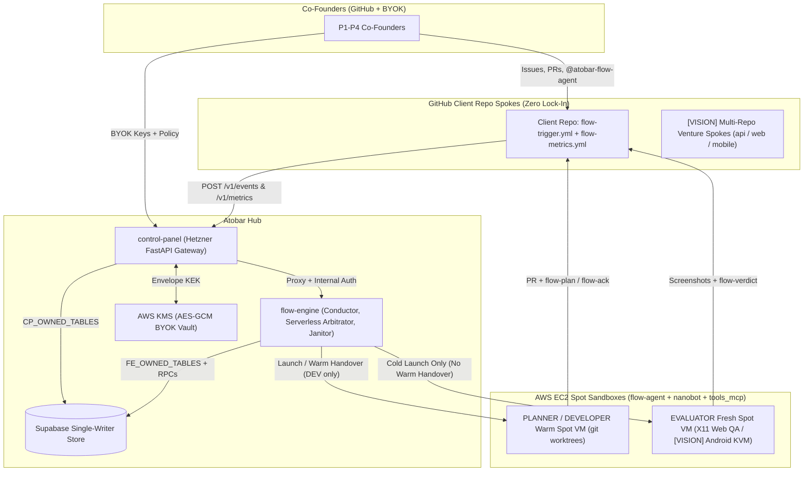

# J51 (prd-hld-and-scrollytelling-reconciliation): Reconcile As-Built Architecture with Co-Founder BYOK Vision: Publish PRD, HLD & Scrollytelling Spec

- **Priority:** P0 (Pre-requisite for `https://github.com/atobar-flow` publication)
- **Milestone:** M07 / M11 (Product, Architecture & Scrollytelling Consolidation)
- **Scope:** `docs/PRD.md` (new), `docs/HLD.md` (new), `docs/ROADMAP.md`, `docs/SWARM_ARCHITECTURE.md`, `docs/ONBOARDING.md`, `docs/README.md`, `README.md`

---

## Goal

Update `atobar-flow` (**ATOBAR** — **Agentic Teams On BYOK And Repos**) docs to match the code through `J50`, write the Product Requirements Document (`docs/PRD.md`) and High-Level Design (`docs/HLD.md`) in plain English, and define the scrollytelling storyboard for `https://github.com/atobar-flow`.

---

## Part 1 — Vision & Documentation Audit

### 1.1 Core Thesis
1. **Shared BYOK & Granular Cost Routing:** Co-founders and teams bring their own LLM API keys (BYOK) to build multi-repo products together—sharing costs and routing keys and models on a **per-repo, per-role** level today (`[AS-BUILT]`), with more granular **per-invoking-user** key management on the roadmap (`[VISION]`).
2. **Fair Equity Split Among Strangers:** Because AI writes the boilerplate, founder value comes from two tracked inputs: **(a) Fiscal spend** (tokens + compute paid) and **(b) Architectural work** (Jumbo Issues, specs, and PR course-corrections that ship working features). Atobar records both so collaborators who have never met can split equity or revenue fairly.
3. **Architecture Lives in GitHub:** Humans coordinate with each other and with agents only through **Jumbo Issues** (macro plans) and **Pull Requests** (code, screenshots, and CI metric checks).
4. **Unattended Visual & Mobile QA:** An isolated `EVALUATOR` Spot VM boots the real app, captures verified X11/Playwright screenshots today, and supports workload-specific Spot images (such as **Android Studio / KVM emulators** for mobile apps) next.
5. **Clean SaaS Lifecycle & Zero Lock-In:** Atobar is a thin Hub-and-Spoke wrapper around GitHub: client repos keep only two workflow files (`flow-trigger.yml` and `flow-metrics.yml`) and can detach or sunset with zero runtime lock-in.

---

### 1.2 Audit of Current `docs/` vs. Code (`HEAD` @ J50)

| Document | Current Scope | Drift vs. Code (`J34`–`J50`) | Gap vs. Vision |
| :--- | :--- | :--- | :--- |
| `README.md` & `docs/ROADMAP.md` | Factory overview + `M01`–`M11` backlog | Still references old single-package `src/flow_engine/` paths (replaced in `J34` by 5 packages: `contracts`, `flow-engine`, `control-panel`, `flow-agent`, `atobar-ops`), says BYOK keys are "not yet consumed by agents", says the goal loop is "planned, not built", and omits `J42`–`J50`. | Describes a single-admin repo tool instead of a multi-founder BYOK venture hub. |
| `docs/SWARM_ARCHITECTURE.md` | 4-role topology, envelopes, failure modes | Uses ASCII art instead of Mermaid, says the goal loop is unbuilt, and says `EVALUATOR`/`ARBITRATOR` reuse the same warm Spot VM as `DEVELOPER` (forbidden since `J43` `#341` via `WARM_HANDOVER_FORBIDDEN_ROLES`). | Models 1 Tenant = 1 Repo; lacks multi-repo Venture spokes. |
| `docs/ONBOARDING.md` | 8-stage onboarding (`onboard.sh`, metrics, labels) | Says the goal loop is "planned, not built" and omits `J49` `@atobar-flow-agent` steering and `J50` Mermaid `SotaWiki` auto-refresh. | Assumes one admin pasting one API key instead of co-founders pooling keys. |
| `docs/E2E_RUNBOOK.md` & `docs/CROSS_SERVICE_CHANGES.md` | Operator runbooks & cross-service wiring rules | Up to date with `atobar-ops` and `J42`–`J50`. | Maintainer runbooks, not a reader-facing PRD or HLD for `https://github.com/atobar-flow`. |

---

### 1.3 The 5 Reconciliation Deltas (`[AS-BUILT]` vs. `[VISION]`)

| # | Area | As-Built Today (`[AS-BUILT @ J50]`) | Target Extension (`[VISION]`) |
| :--- | :--- | :--- | :--- |
| **D1** | **BYOK Routing & Equity Ledger** | KMS envelope-encrypted (`AES-GCM`) BYOK keys per `(tenant_id, provider)` in `tenant_llm_keys` and per-repo, per-role routing in `tenant_role_llm`. Per-turn cache-aware LLM cost is recorded in `loop_rounds.cost_usd` and `tenant_goals.spent_usd` (`J48` `#360` adds verifiable LiteLLM + AWS Spot price tables). | **Per-Invoking-User Key Routing & Equity Ledger:** Scope keys to invoking GitHub users or pooled co-founder budgets (`contributor_github_login`, `monthly_cap_usd`). Every round credits **(a) Fiscal Spend** to the key owner and **(b) Architectural Yield** to the author of the Jumbo Issue, Spec, or PR steer. |
| **D2** | **Hub-and-Spoke Topology** | Hub (`control-panel` + `flow-engine` + Supabase) wraps a single GitHub Client Repo (`tenants`). Client repo holds only `.github/workflows/flow-trigger.yml` and `flow-metrics.yml`. | **Multi-Repo Venture Spokes:** Group N microservice repos under one Venture (`ventures -> tenants`), keeping every client repo 100% standalone. |
| **D3** | **Human Collaboration** | Spec-Sufficiency Gate (`J38`), `PLANNER` (`flow-plan`), `DEVELOPER` (`flow-ack`), `EVALUATOR` (`flow-verdict`), `ARBITRATOR` (`flow-arbitration`), and `@atobar-flow-agent` comments (`J49`: Issue = Plan, PR = Correction). | **Jumbo Issues as Architectural Capital:** Track cross-repo Jumbo Issues and PR steers by time-to-merge and goal progress. |
| **D4** | **Unattended Visual & Mobile QA** | Two-Stage Evaluator (`J39` static `file:#L` check + `J49` X11/Playwright screenshots with `xwininfo` and process proof) on an isolated ARM64 `t4g.large` Spot VM. | **Pluggable Spot Image Profiles (`machine_image_profile`):** Per-repo Spot AMIs: `web-x11-arm64` (default), `android-studio-kvm-x86` (headless Android Emulator + ADB for mobile apps), and `fullstack-compose`. |
| **D5** | **Lifecycle & Sunset** | Per-PR (`max_pr_cost_usd`, `max_review_rounds`, `max_repeat_finding`) and Per-Goal (`tenant_goals`) circuit breakers. | **Build -> Harvest -> Sunset:** Lifecycle presets with 1-commit clean exit (delete workflow files; zero runtime lock-in). |

---

## Part 2 — Personas & User Journeys

### 2.1 User Personas (`P1`–`P4`)

1. **P1 — Token-Staking Co-Founder (*Capital & Architecture Partner*):** Shares BYOK API keys across repos, roles, or invoking users. Needs KMS-encrypted key storage and a clear ledger of fiscal spend and shipped specs.
2. **P2 — Swarm Wrangler (*Architecture Operator*):** Breaks system work into Jumbo Issues, reviews `flow-plan` checklists, and steers PRs on GitHub using `@atobar-flow-agent` comments.
3. **P3 — QA Gatekeeper (*Release Verifier*):** Relies on an isolated `EVALUATOR` VM (`contents: read` token, X11 or Android emulator screenshots) and a deterministic `ARBITRATOR` that checks real CI metrics (`flow-metrics.json`) before merge.
4. **P4 — FinOps & Sunset Steward (*Budget Controller*):** Tracks per-PR and per-goal budgets, enforces hard cost/stall caps, and detaches client repos cleanly at sunset.

---

### 2.2 End-to-End User Journeys (`J1`–`J6`)

- **J1 — Repo Onboarding & Pooled BYOK (~5 Min):**
  1. `[AS-BUILT]` Co-founder signs into Control Panel with GitHub OAuth, installs `atobar-flow-agent`, and runs `onboard.sh`.
  2. `[AS-BUILT + VISION]` Co-founders add KMS-encrypted BYOK keys (`gemini`, `claude`, `openai`, `deepseek`, `grok`) and pick models per role; `[VISION]` tags each key with the co-founder's GitHub login and monthly USD cap.
  3. `[AS-BUILT]` The `onboarder` Spot role generates the repo's `SotaWiki` (with a validated Mermaid diagram, `J50`) and opens the PR adding `flow-trigger.yml` and `flow-metrics.yml`.
- **J2 — Jumbo Issue Planning & Fast-Track Gate:**
  1. `[AS-BUILT]` Co-founder sets repo target metrics and goal budgets (`tenant_goals`) and opens an Issue.
  2. `[AS-BUILT]` On `flow:feature` / `flow:plan` (or `@atobar-flow-agent` on an Issue), the deterministic Spec-Sufficiency Gate (`J38`) sends concrete specs straight to `DEVELOPER` or runs `PLANNER` to post a `flow-plan` checklist and wait for `flow:approved`.
  3. `[VISION]` A Venture Jumbo Issue links child issues across `api`, `web`, and `mobile` spoke repos.
- **J3 — Agent Execution, Warm Developer Handover & PR Steering:**
  1. `[AS-BUILT]` `CONDUCTOR` launches an EC2 Spot sandbox. `PLANNER -> DEVELOPER` and rework turns reuse the warm Spot VM in isolated `git worktree` checkouts (`POST /v1/runs/{run_id}/turn-complete`), while `EVALUATOR` is blocked from warm handover (`WARM_HANDOVER_FORBIDDEN_ROLES`, `J43`) and always boots on a fresh Spot VM.
  2. `[AS-BUILT]` Live tool calls and USD spend stream into the pinned GitHub status comment.
  3. `[AS-BUILT]` Co-founders steer PRs in plain English with `@atobar-flow-agent` comments (`J49`).
- **J4 — Unattended Visual & Mobile QA:**
  1. `[AS-BUILT]` `EVALUATOR` checks out exact `head_sha`, waits for GitHub Actions CI, and runs Stage 1 static `file:<path>#L<start>-L<end>` checks (`J39`).
  2. `[AS-BUILT]` In Stage 2, `EVALUATOR` starts the app under X11, checks open windows (`xwininfo`) and running processes (`ps`), uploads screenshots with `data_mode` (`live` | `synthetic` | `hybrid`) (`J49`), and posts `flow-verdict`.
  3. `[VISION]` Repos with `machine_image_profile: android-studio-kvm-x86` boot a KVM Spot AMI with Android Emulator + ADB so `EVALUATOR` captures native mobile screenshots.
- **J5 — Deterministic Metric Gate, Cost Settlement & Auto-Merge:**
  1. `[AS-BUILT]` When CI is green, verdict is `approved`, and disputes are empty on `head_sha`, `ARBITRATOR` verifies `flow-metrics.json` provenance and runs the pure `arbitrate()` function (no LLM).
  2. `[AS-BUILT]` Based on `arbitration.mode` (`shadow` -> `recommend` -> `auto_merge`), the PR is logged, recommended, or squash-merged, and `repository_wikis` queues a coalesced Mermaid `SotaWiki` refresh (`J50`).
  3. `[AS-BUILT + VISION]` `flow-engine` records turn spend in `loop_rounds` and `tenant_goals` (`[IN PR #364: J48]` settles against pinned LiteLLM + AWS Spot price snapshots; `[VISION]` credits the co-founder equity ledger).
- **J6 — Harvest & Zero-Lock-In Sunset:**
  1. `[AS-BUILT]` When `tenant_goals` targets are met, the goal loop marks the goal `met` and guardrails block regressions.
  2. `[AS-BUILT + VISION]` Co-founders export the contribution ledger and detach any client repo by deleting `.github/workflows/flow-trigger.yml` and `flow-metrics.yml`.

---

## Part 3 — Architecture Overview & `PRD.md` / `HLD.md` Structure



### 3.1 `docs/PRD.md` Sections
1. **§1 Vision & BYOK Cost Routing:** Per-repo, per-role BYOK routing (`[AS-BUILT]`), per-invoking-user key management on the roadmap (`[VISION]`), and zero-lock-in GitHub spokes.
2. **§2 Personas (`P1`–`P4`) & Anti-Goals:** Roles, stakes, and what Atobar never builds.
3. **§3 User Journeys (`J1`–`J6`):** Step-by-step tables with `[AS-BUILT]` and `[VISION]` badges.
4. **§4 Functional (`FR-1`..`FR-7`) & Non-Functional (`NFR-1`..`NFR-4`) Requirements.**
5. **§5 `https://github.com/atobar-flow` Scrollytelling Storyboard:** 7 scenes mapping narrative beats, personas, and diagrams.

### 3.2 `docs/HLD.md` Sections (Derived from `docs/PRD.md`)
1. **§1 System Context & Hub-and-Spoke Topology (Mermaid Flowchart).**
2. **§2 Core Runtime Sequences (Mermaid Sequence Diagrams):**
   - Ingress, PR-to-Issue resolution (`J49`), and Spec-Sufficiency Gate (`J38`).
   - Warm Spot handover (`PLANNER -> DEVELOPER`) vs. fresh Spot launch for `EVALUATOR` (`J43`), single-use `/llm-key`, and `/github-token`.
   - Two-Stage `EVALUATOR` (`J39` + `J49`) -> deterministic `ARBITRATOR` -> coalesced `SotaWiki` refresh (`J50`).
   - Cost recording (`loop_rounds`, `tenant_goals`), `J48` price catalog (`#360`), and co-founder ledger settlement.
3. **§3 Data Architecture & Single-Writer Ownership (Mermaid ER Diagram + Table Matrix):** Exact match with `tests/test_table_ownership.py` (`CP_OWNED_TABLES` vs. `FE_OWNED_TABLES`).
4. **§4 Vision Blueprints:**
   - **§4.1 Co-Founder BYOK Pool & Equity Ledger (`FR-5`):**
     ```text
     Fiscal_Share(founder_i) = (LLM_Spend_i + Spot_Compute_Spend_i) / Total_Venture_Spend
     Architectural_Yield(founder_i) = Merged_PRs_and_Goal_Progress_from(Jumbo_Issues_i + Specs_i + PR_Steers_i)
     ```
   - **§4.2 Multi-Repo Venture Spokes (`FR-7`):** `ventures`, `tenants.venture_id`, and `venture_jumbo_links`.
   - **§4.3 Pluggable Spot Image Profiles (`FR-4`):** `machine_image_profile: Literal["web-x11-arm64", "android-studio-kvm-x86", "fullstack-compose"]` in `TenantManifest` and `dispatch.py`.
5. **§5 PRD-to-HLD Traceability Matrix.**

---

## Part 4 — Work Packages & Acceptance Criteria

- **WP-1:** Update `README.md`, `docs/README.md`, `docs/ONBOARDING.md`, `docs/SWARM_ARCHITECTURE.md`, and `docs/ROADMAP.md` to match the 5-package monorepo and `J38`–`J50`.
- **WP-2:** Publish `docs/PRD.md` in simple plain English.
- **WP-3:** Publish `docs/HLD.md` with GitHub-valid Mermaid diagrams and exact code/table references.
- **WP-4:** Validate all Mermaid diagrams and markdown links via `uv run --no-sync atobar-ops verify --changed`.

## Acceptance Criteria
- [ ] **AC-1:** `docs/PRD.md` and `docs/HLD.md` exist, use simple plain English, contain zero references to external comparative systems, and tag `[AS-BUILT]` vs. `[VISION]`.
- [ ] **AC-2:** `docs/PRD.md` covers per-repo, per-role BYOK cost sharing (`[AS-BUILT]`) and per-invoking-user key management on the roadmap (`[VISION]`), Personas `P1`–`P4`, Journeys `J1`–`J6`, `FR-1`..`FR-7`, `NFR-1`..`NFR-4`, and the 7-scene storyboard for `https://github.com/atobar-flow`.
- [ ] **AC-3:** `docs/HLD.md` includes valid GitHub Mermaid diagrams for Hub-and-Spoke topology, Spot handover + isolation boundary, Two-Stage Evaluator + Arbitrator + Wiki refresh, Cost Settlement, and ER schema, plus the 3 Vision blueprints (Equity Ledger, Multi-Repo Ventures, Android Studio KVM profile).
- [ ] **AC-4:** `README.md`, `docs/ROADMAP.md`, `docs/SWARM_ARCHITECTURE.md`, `docs/ONBOARDING.md`, and `docs/README.md` match the 5-package layout and `J38`–`J50` code.
- [ ] **AC-5:** `uv run --no-sync atobar-ops verify --changed` passes with zero errors.
