# J52 (public-org-migration-and-user-zero): Public Domain Migration to `github.com/atobar-flow`, `$CP_HOSTNAME` Re-Homing, GHCR Service Separation, Terraform GitHub App Provisioning, and "User Zero" Full-Reset Bootstrap

- **Priority:** P0 (Open-Source Launch & Public Organization Cutover)
- **Milestone:** M11 (Public Domain Release & User-Zero Self-Hosting)
- **Target Organization & Repo:** `https://github.com/atobar-flow/atobar-flow` (Pages companion: `https://github.com/atobar-flow/atobar-flow.github.io` at `~/projects/atobar-flow.github.io`)
- **Target Control Panel Domain:** `https://$CP_HOSTNAME` (fresh Hetzner Primary IPv4 allocated via Terraform output)

---

## Goal

Migrate Atobar Flow from the private personal repository (`atobar-flow/atobar-flow`, `<legacy-cp-host>`) to the public **`github.com/atobar-flow`** organization (`atobar-flow/atobar-flow`, `$CP_HOSTNAME`) with:
1. **Zero-Leak Single-Commit Epoch Cutover:** Retire `~/projects/atobar-flow` to `~/projects/atobar-flow-RETIRE`, initialize `github.com/atobar-flow/atobar-flow` with a clean single-commit history, and clone it back to `~/projects/atobar-flow`.
2. **"User Zero" Full-Reset & Re-Adoption Experience:** Support tearing down 100% of Terraform resources (`terraform destroy` across all 4 workspaces) and destroying the legacy `atobar-flow-agent` GitHub App, then re-provisioning from scratch seeded only by a local gitignored `.env` (copied from `.env.sample`).
3. **First-Class GitHub App Provisioning in Terraform:** Replace the `CHANGE_ME_MANUALLY_IN_AWS_CONSOLE` SSM placeholders and missing `github_oauth` secret with a 1-command GitHub App Manifest bootstrapper (`atobar-ops init-app`) that mints the new `atobar-flow-agent` App under `github.com/atobar-flow` and feeds its credentials directly into Terraform (`identity/` & `control-panel-hetzner/`).
4. **Public GHCR Container Separation:** Build and publish `ghcr.io/atobar-flow/control-panel` and `ghcr.io/atobar-flow/flow-engine` in CI so production Hetzner pulls immutable public images instead of cloning source code and running `docker build` on the production host.
5. **100% Configuration Abstraction & `atobar-init` Fold-In:** Eliminate all hardcoded `<legacy-domain>`, `arsenyspb`, AWS account (`<aws-account-id>`), region (`us-west-2` / `ap-southeast-2`), and Supabase project (`<supabase-project-ref>`) literals, and fold `<legacy-init-repo>` (`onboard.sh`) into `atobar-flow/atobar-flow` + `GET https://$CP_HOSTNAME/onboard.sh`.

---

## Part 1 — Architecture & Provisioning Evolution

### 1.1 End-to-End "User Zero" Provisioning Path

```mermaid
flowchart LR
  subgraph Local["1. Operator Workstation (.env from .env.sample)"]
    ENV[".env (gitignored)\nOrg, Domain, AWS, Hetzner, Supabase, TFC"]
    APP_INIT["atobar-ops init-app\n(GitHub App Manifest Flow -> .env)"]
    SYNC["atobar-ops infra sync-vars\n(.env -> HCP Terraform + GH Actions Vars)"]
  end

  subgraph TFC["2. HCP Terraform (4 Workspaces in Dependency Order)"]
    W1["foundation/\nVPC, Subnet, Spot SG, GitHub OIDC Roles"]
    W2["identity/\nKMS CMK, Spot Profile, GitHub App SSM + OAuth SM"]
    W3["control-panel/\nSupabase SM, Spot Launch Template (AMI w/ Ubuntu fallback)"]
    W4["control-panel-hetzner/\nHetzner Primary IPv4 + cx23 Server + IAM Keys"]
  end

  subgraph Runtime["3. Public Runtime & Delivery"]
    DNS["DNS A Record\n$CP_HOSTNAME -> outputs.server_ipv4"]
    GHCR["Public GHCR\nghcr.io/atobar-flow/{control-panel,flow-engine}"]
    CP["Hetzner Control Panel\nhttps://$CP_HOSTNAME (Caddy TLS + docker compose pull)"]
    SPOT["AWS EC2 Spot Sandbox\nAnony-clones public atobar-flow/atobar-flow @ 40-char SHA"]
  end

  ENV --> APP_INIT --> SYNC
  SYNC --> W1 --> W2 --> W3 --> W4
  W4 -->|"outputs.server_ipv4"| DNS --> CP
  GHCR -->|"docker compose pull"| CP
  CP -->|"RunInstances"| SPOT
```



### 1.2 The 5 Architectural Deltas

| # | Area | Current State (`atobar-flow/atobar-flow`) | Target Public State (`atobar-flow/atobar-flow`) |
| :--- | :--- | :--- | :--- |
| **1** | **GitHub App Lifecycle (`atobar-flow-agent`)** | Owned by personal account `arsenyspb` (App ID `4396774`). `identity/secrets.tf` writes `CHANGE_ME_MANUALLY_IN_AWS_CONSOLE` with `ignore_changes = [value]`; `flow/control-panel/github_oauth` is not in Terraform at all. | Old App destroyed; new `atobar-flow-agent` created under `github.com/atobar-flow` via `atobar-ops init-app` (GitHub App Manifest Flow) and managed by Terraform variables in `identity/secrets.tf` (SSM `/flow/github/*` + Secrets Manager `flow/control-panel/github_oauth`). |
| **2** | **Container Build vs. Runtime Pull** | `refresh.sh` on Hetzner mints a GitHub App token every 5 min, runs `git fetch` on `/opt/atobar-flow`, and runs `docker build` locally on the `cx23` host. | `.github/workflows/control_panel_build.yml` publishes images to public `ghcr.io/atobar-flow/control-panel` and `ghcr.io/atobar-flow/flow-engine` (free unlimited public GHCR storage). `refresh.sh` pulls pre-built images via `docker compose pull`. |
| **3** | **Domain, IP, Region & Identity Abstraction** | Hardcodes `<legacy-cp-host>` (11 files), `atobar-flow/atobar-flow` (OIDC, Spot `cloud_init.sh.tpl`, `github_rest.py`), `<aws-account-id>` & `us-west-2` & `<supabase-project-ref>` (workflows & `creds.py`). | Seeded from `.env` (copied from `.env.sample`). Default domain is `$CP_HOSTNAME`; fresh Hetzner IPv4 allocated via Terraform output `server_ipv4`; workflows read `vars.AWS_REGION`, `vars.AWS_PACKER_ROLE_ARN`, `vars.AWS_DISPATCHER_ROLE_ARN`, and `flow/supabase/credentials`. |
| **4** | **"User Zero" Teardown & Cold-Start Resilience** | `prevent_destroy = true` on `hcloud_primary_ip.cp` and `llm_kek`; 30-day AWS Secrets Manager recovery windows block secret re-creation; `data.aws_ami.ubuntu` fails if Packer hasn't run yet. | Configurable `secret_recovery_window_days = 0` (for clean reset), `prevent_destroy` removed/parameterized, KMS `deletion_window_in_days = 7`, and `launch_template.tf` falls back to Canonical Ubuntu 24.04 ARM64 AMI until first Packer build completes. |
| **5** | **Repo Cutover & `atobar-init` Fold-In** | 326-commit private history containing personal email, account IDs, and `<legacy-domain>`; separate `<legacy-init-repo>` repo for `onboard.sh`. | `~/projects/atobar-flow` renamed to `~/projects/atobar-flow-RETIRE`; fresh 1-commit epoch pushed to `atobar-flow/atobar-flow` and cloned to `~/projects/atobar-flow`. `onboard.sh` folded into `scripts/onboard.sh` and served dynamically at `GET https://$CP_HOSTNAME/onboard.sh`. |

---

## Part 2 — Complete Inventory of Hardcoded References to Abstract

### 2.1 `.env.sample` -> `.env` Specification
Rename `.env.example` to `.env.sample` and update `.gitignore` (`.env`, `.env.*`, `!.env.sample`). `.env.sample` must define all seed variables for local CLI, Terraform variable sync, and GitHub Actions variable sync:

```dotenv
# --- 1. GitHub Organization & Repository Identity ---
FLOW_GITHUB_ORG=atobar-flow
FLOW_FACTORY_REPO=atobar-flow/atobar-flow
CP_GITHUB_APP_SLUG=atobar-flow-agent
CP_ADMIN_LOGINS=arsenyspb

# --- 2. Control Panel Public Endpoint ---
CP_HOSTNAME=$CP_HOSTNAME
CP_PUBLIC_URL=https://$CP_HOSTNAME

# --- 3. GitHub App Credentials (Populated by `atobar-ops init-app`) ---
GITHUB_APP_ID=
GITHUB_APP_INSTALLATION_ID=
GITHUB_APP_PRIVATE_KEY_BASE64=
GITHUB_OAUTH_CLIENT_ID=
GITHUB_OAUTH_CLIENT_SECRET=

# --- 4. HCP Terraform Configuration ---
TF_CLOUD_ORGANIZATION=your-tfc-org
TFC_PROJECT_ID=prj-your-project-id
TFC_VARSET_ID=varset-your-varset-id
TFC_WS_FOUNDATIONS=atobar-flow-foundations
TFC_WS_IDENTITY=atobar-flow-identity
TFC_WS_CONTROL_PANEL=atobar-flow-control-panel
TFC_WS_HETZNER=atobar-flow-control-panel-hetzner

# --- 5. Cloud Provider Credentials & Regions ---
AWS_REGION=us-west-2
AWS_ACCESS_KEY_ID=
AWS_SECRET_ACCESS_KEY=
HCLOUD_TOKEN=
HCLOUD_LOCATION=fsn1
HCLOUD_SERVER_TYPE=cx23
SSH_ALLOWED_CIDRS=["0.0.0.0/0"]

# --- 6. Supabase Configuration ---
SUPABASE_URL=https://your-project.supabase.co
SUPABASE_SERVICE_KEY=
SUPABASE_DB_PASSWORD=
SUPABASE_PGHOST=aws-0-us-west-2.pooler.supabase.com
SUPABASE_PGPORT=5432
SUPABASE_PGUSER=postgres.your-project-ref
SUPABASE_SECRET_NAME=flow/supabase/credentials
```

### 2.2 File-by-File Hardcoded Reference Map

| File | Current Hardcoded Literal | Required Change |
| :--- | :--- | :--- |
| `infra/terraform/foundation/variables.tf` | *(empty)* | Add `variable "aws_region" { default = "us-west-2" }`, `variable "factory_repo" { default = "atobar-flow/atobar-flow" }`. |
| `infra/terraform/foundation/iam_oidc.tf` | `repo:atobar-flow/atobar-flow:ref:refs/heads/main` | Interpolate `repo:${var.factory_repo}:ref:refs/heads/main`. |
| `infra/terraform/foundation/iam_packer.tf` | `repo:atobar-flow/atobar-flow:ref:refs/heads/main` | Interpolate `repo:${var.factory_repo}:ref:refs/heads/main`. |
| `infra/terraform/identity/secrets.tf` | `CHANGE_ME_MANUALLY_IN_AWS_CONSOLE` + `ignore_changes` | Bind `/flow/github/app_id`, `/flow/github/app_installation_id`, `/flow/github/app_private_key` to Terraform variables (`var.github_app_id`, etc.) and add `aws_secretsmanager_secret.github_oauth` (`flow/control-panel/github_oauth`) with `recovery_window_in_days = var.secret_recovery_window_days`. |
| `infra/terraform/identity/kms.tf` | `deletion_window_in_days = 30` | Set `deletion_window_in_days = var.kms_deletion_window_days` (default `7`). |
| `infra/terraform/control-panel/providers.tf` | `organization = "your-tfc-org"` in `terraform_remote_state` | Use `organization = var.tfc_organization_name` in both `terraform_remote_state` data sources. |
| `infra/terraform/control-panel/launch_template.tf` | `data.aws_ami.ubuntu` fails when `flow-sandbox-v*` count is 0 | Query both `flow-sandbox-v*` (self) and Canonical Ubuntu 24.04 ARM64 (`099720109477`), selecting `coalesce(try(data.aws_ami.sandbox[0].id, null), data.aws_ami.ubuntu_base.id)`, and pass `factory_repo = var.factory_repo` into `cloud_init.sh.tpl`. |
| `infra/terraform/control-panel/supabase.tf` | Stores only `api_url`, `service_key`, `db_password` | Also store `pghost = var.supabase_pghost`, `pgport = var.supabase_pgport`, `pguser = var.supabase_pguser`; set `recovery_window_in_days = var.secret_recovery_window_days`. |
| `infra/terraform/control-panel/scripts/cloud_init.sh.tpl` | `https://github.com/atobar-flow/atobar-flow.git` | Use templated `${factory_repo}` (default `atobar-flow/atobar-flow`); clone anonymously when public, falling back to `ENGINE_TOKEN` only if private. |
| `infra/terraform/control-panel-hetzner/variables.tf` | `factory_repo = "atobar-flow/atobar-flow"`, `cp_hostname = "<legacy-cp-host>"` | Default `factory_repo = "atobar-flow/atobar-flow"`, `cp_hostname = "$CP_HOSTNAME"`, add `secret_recovery_window_days = 0`, `ghcr_image_prefix = "ghcr.io/atobar-flow"`. |
| `infra/terraform/control-panel-hetzner/main.tf` | `prevent_destroy = true` on `llm_kek` and `hcloud_primary_ip.cp` | Remove `prevent_destroy = true` (or control via lifecycle/variable) and set `recovery_window_in_days = var.secret_recovery_window_days` on all Secrets Manager secrets so `terraform destroy` + re-apply works cleanly. |
| `infra/control-panel/docker-compose.yml` & `refresh.sh` | Clones repo and runs `docker build` on Hetzner | Pull `ghcr.io/atobar-flow/control-panel:${IMAGE_TAG}` and `ghcr.io/atobar-flow/flow-engine:${IMAGE_TAG}` (with fallback to local build only if `CP_BUILD_FROM_SOURCE=1`). |
| `.github/workflows/control_panel_build.yml` | Builds `control-panel:local` and discards it | On push to `main`, log into `ghcr.io` with `GITHUB_TOKEN` (`packages: write`) and push `ghcr.io/${{ github.repository_owner }}/control-panel` and `ghcr.io/${{ github.repository_owner }}/flow-engine` tagged with `:sha-${{ github.sha }}` and `:latest`. |
| `.github/workflows/packer-build.yml` | `AWS_REGION: us-west-2`, `arn:aws:iam::<aws-account-id>:role/flow-gha-packer-role` | Use `${{ vars.AWS_REGION || 'us-west-2' }}` and `${{ vars.AWS_PACKER_ROLE_ARN }}`; pass `-var "aws_region=..."` to `packer build`. |
| `.github/workflows/supabase-migrate.yml` | Hardcoded `ROLE_ARN`, `PGHOST`, `PGUSER` (`<supabase-project-ref>`) | Use `${{ vars.AWS_REGION || 'us-west-2' }}` and `${{ vars.AWS_DISPATCHER_ROLE_ARN }}`; read `pghost`, `pgport`, `pguser`, `db_password` from `flow/supabase/credentials` in AWS Secrets Manager. |
| `infra/packer/flow-sandbox.pkr.hcl` | `region = "us-west-2"` | Add `variable "aws_region" { default = "us-west-2" }` and set `region = var.aws_region`. |
| `contracts/src/atobar_contracts/{api,issue_states,arbitration,github_rest,client_templates}.py` | `https://<legacy-cp-host>`, `atobar-flow/atobar-flow`, `<legacy-init-repo>` | Replace defaults with `https://$CP_HOSTNAME`, `atobar-flow/atobar-flow`, remove the fragile string-replace block in `github_rest.py:220-255`, and point onboarding script URL to `${cp_url}/onboard.sh`. |
| `control-panel/src/control_panel/{app,web,github}.py` | `https://<legacy-cp-host>`, `atobar-flow/atobar-flow` | Default `CP_PUBLIC_URL` to `https://$CP_HOSTNAME`, `FLOW_FACTORY_REPO` to `atobar-flow/atobar-flow`, and add `GET /onboard.sh` endpoint rendering `scripts/onboard.sh` with live `CP_PUBLIC_URL` and `CP_GITHUB_APP_SLUG`. |
| `flow-engine/src/flow_engine/api.py` | `https://<legacy-cp-host>`, `atobar-flow/atobar-flow` | Default `CP_PUBLIC_URL` to `https://$CP_HOSTNAME` and `FLOW_FACTORY_REPO` to `atobar-flow/atobar-flow`. |
| `atobar-ops/src/atobar_ops/{cli,creds}.py` | `<legacy-cp-host>`, `atobar-flow/atobar-flow`, `<supabase-project-ref>` | Load defaults from `.env` / env vars (`CP_PUBLIC_URL="https://$CP_HOSTNAME"`, `FLOW_FACTORY_REPO="atobar-flow/atobar-flow"`, `SUPABASE_URL` from env/AWS SM with no hardcoded project ref). |

---

## Part 3 — Adversarial Analysis of Edge Cases & Failure Modes

| # | Scenario / Component | Edge Case / Failure Mode | Mitigation & Deterministic Guard |
| :--- | :--- | :--- | :--- |
| **EC-1** | **Workspace Rename (`~/projects/atobar-flow` $\rightarrow$ `~/projects/atobar-flow-RETIRE`)** | Running `mv` from inside `~/projects/atobar-flow` leaves the active shell/agent process attached to the old directory inode (`atobar-flow-RETIRE`), and moving `.venv/` breaks hardcoded shebang/`.pth` paths. | Perform the swap from parent directory `/Users/chernov/projects`, copy gitignored `.env` from `atobar-flow-RETIRE/.env` into the fresh clone `~/projects/atobar-flow/.env`, and run `uv sync --locked` inside the new clone (warm from `~/.cache/uv` in ~2s). |
| **EC-2** | **Destroying `atobar-flow-agent` & Global Slug Reservation** | GitHub App slugs (`atobar-flow-agent`) are globally unique across all of GitHub. If `atobar-ops init-app` runs before the old personal App is deleted, GitHub rejects the manifest with "Name already taken". Furthermore, GitHub REST API does not permit `DELETE /apps/{slug}` via token. | `atobar-ops init-app` pre-flight checks `GET https://api.github.com/apps/{slug}`: if the App still exists under `arsenyspb`, it opens `https://github.com/settings/apps/atobar-flow-agent/advanced` and polls until `GET /apps/{slug}` returns `404`, then immediately launches the GitHub App Manifest POST to `https://github.com/organizations/atobar-flow/settings/apps/new`. |
| **EC-3** | **Full Terraform Destroy ("Lose It All") & Immediate Re-Apply** | AWS Secrets Manager defaults to a 30-day recovery window (`ResourceExistsException` on re-apply), and `prevent_destroy = true` blocks `terraform destroy` on `llm_kek` and `hcloud_primary_ip.cp`. | Set `recovery_window_in_days = var.secret_recovery_window_days` (default `0`) on all `aws_secretsmanager_secret` resources and remove `prevent_destroy = true` so `terraform destroy` + `terraform apply` is idempotent with zero manual AWS CLI cleanup. |
| **EC-4** | **Cold-Start AMI Deadlock on Fresh AWS Account/Region** | `infra/terraform/control-panel/launch_template.tf` queries `data "aws_ami" "ubuntu"` with `owners = ["self"]` and `name = "flow-sandbox-v*"`. On a fresh environment before Packer runs, `terraform apply` fails with `Your query returned no results`. | Use a 2-stage AMI lookup in `launch_template.tf`: if no custom `flow-sandbox-v*` AMI exists yet, fall back to Canonical's official `ubuntu-noble-24.04-arm64-server-*` AMI (`099720109477`) so `control-panel` workspace applies cleanly before the first Packer build. |
| **EC-5** | **Spot VM `ENGINE_REF` 40-char SHA Mismatch After Single-Commit Epoch** | Spot VMs validate `ENGINE_REF =~ ^[0-9a-f]{40}$` and checkout that SHA from `atobar-flow/atobar-flow`. Old SHAs from `atobar-flow/atobar-flow` do not exist in the new single-commit repo. | Drain/terminate any old Spot instances before cutover; Hetzner `refresh.sh` records the new repo's `HEAD` SHA (or image label SHA) into `ENGINE_REF` in `/etc/atobar/cp.env`. |
| **EC-6** | **Caddy Let's Encrypt ACME Race on New Hetzner IP (`$CP_HOSTNAME`)** | When Hetzner boots `hcloud_server.cp` with a brand-new IPv4, Caddy starts before the user updates the DNS `A` record for `$CP_HOSTNAME`, causing ACME validation to fail and enter exponential backoff. | `atobar-ops infra up` prints the new `server_ipv4` immediately after `control-panel-hetzner` apply; `refresh.sh` verifies whether `$CP_HOSTNAME` resolves to the local IPv4 and restarts Caddy once DNS propagation completes. |
| **EC-7** | **First-Commit `gitleaks` Scan in GitHub Actions (`ci.yml`)** | On the initial root commit of `atobar-flow/atobar-flow`, `github.event.before` is all zeros and `HEAD~1` does not exist. | `ci.yml` already falls back to `--log-opts="-1"` when `BEFORE` is zero; verify locally with `gitleaks git --log-opts="-1"` and `gitleaks detect --no-git` before pushing the epoch commit. |

---

## Part 4 — Work Packages (`WP-1`..`WP-6`)

- [x] **WP-1: `.env.sample` & Configuration Ratchet**
  - Rename `.env.example` to `.env.sample`, update `.gitignore` (`!.env.sample`), and populate the full User-Zero variable template (`FLOW_GITHUB_ORG`, `FLOW_FACTORY_REPO`, `CP_HOSTNAME=$CP_HOSTNAME`, `CP_PUBLIC_URL=https://$CP_HOSTNAME`, TFC workspace names, AWS/Hetzner/Supabase keys).
  - Replace all hardcoded `<legacy-cp-host>`, `atobar-flow/atobar-flow`, `<legacy-init-repo>`, and `<supabase-project-ref>` defaults across `contracts/`, `control-panel/`, `flow-engine/`, `atobar-ops/`, `docs/`, and `README.md`.
  - Add a boundary test in `tests/test_boundaries.py` asserting zero occurrences of `<legacy-domain>`, `<aws-account-id>`, or `<supabase-project-ref>` in runtime packages, workflows, and Terraform files.

- [x] **WP-2: Fold `atobar-init` (`onboard.sh`) into Main Repo & Control Panel**
  - Add `scripts/onboard.sh` (migrated from `<legacy-init-repo>`) with `CP_URL="${ATOBAR_CP_URL:-https://$CP_HOSTNAME}"`.
  - Add `GET /onboard.sh` in `control-panel/src/control_panel/app.py` that dynamically renders `scripts/onboard.sh` with the server's configured `CP_PUBLIC_URL` and `CP_GITHUB_APP_SLUG`, and copy `onboard.sh` to `~/projects/atobar-flow.github.io/onboard.sh`.

- [x] **WP-3: Public GHCR Container Pipeline & Pull-Based Hetzner Runtime**
  - Update `.github/workflows/control_panel_build.yml` to build and push `ghcr.io/${{ github.repository_owner }}/control-panel` and `ghcr.io/${{ github.repository_owner }}/flow-engine` (`:sha-<commit>` and `:latest`) on pushes to `main`.
  - Update `infra/control-panel/docker-compose.yml` and `infra/control-panel/refresh.sh` to pull pre-built images from GHCR instead of running `git clone` + `docker build` on the Hetzner server.

- [x] **WP-4: Terraform Generalization & "User Zero" Full-Teardown Support**
  - Parameterize `factory_repo`, `tfc_organization_name`, `cp_hostname`, and `secret_recovery_window_days = 0` across `foundation/`, `identity/`, `control-panel/`, and `control-panel-hetzner/`.
  - Remove `prevent_destroy = true` blockers, add the Canonical Ubuntu 24.04 ARM64 AMI fallback in `control-panel/launch_template.tf`, and manage `flow/control-panel/github_oauth` and full GitHub App SSM parameters via Terraform variables in `identity/secrets.tf`.
  - Update `.github/workflows/packer-build.yml` and `supabase-migrate.yml` to use GitHub Actions `vars.AWS_REGION`, `vars.AWS_PACKER_ROLE_ARN`, `vars.AWS_DISPATCHER_ROLE_ARN`, and AWS Secrets Manager `flow/supabase/credentials`.

- [x] **WP-5: `atobar-ops` User-Zero Bootstrapper (`init-app` & `infra`)**
  - Add `atobar-ops init-app`: checks that the old `atobar-flow-agent` slug is released (opening the deletion settings page if still owned by `arsenyspb`), runs a localhost callback server to execute the **GitHub App Manifest Flow** under `github.com/atobar-flow` with callback `https://$CP_HOSTNAME/auth/callback`, and saves the generated `GITHUB_APP_ID`, `GITHUB_APP_PRIVATE_KEY_BASE64`, `GITHUB_OAUTH_CLIENT_ID`, and `GITHUB_OAUTH_CLIENT_SECRET` to `.env`.
  - Add `atobar-ops infra sync-vars`, `atobar-ops infra up`, and `atobar-ops infra destroy` to push `.env` variables into HCP Terraform workspaces / variable sets and orchestrate full teardown and bring-up in dependency order.

- [ ] **WP-6: Execute "User Zero" Teardown, New Repo Epoch & Cutover**
  - Run full verification (`uv run --no-sync atobar-ops verify`).
  - Destroy old `atobar-flow-agent` App and run `atobar-ops infra destroy` to verify clean teardown.
  - Create public repository `github.com/atobar-flow/atobar-flow`, stage a clean single-commit epoch, rename `~/projects/atobar-flow` $\rightarrow$ `~/projects/atobar-flow-RETIRE`, clone `github.com/atobar-flow/atobar-flow` into `~/projects/atobar-flow`, copy `.env`, run `uv sync --locked`, run `atobar-ops init-app` + `atobar-ops infra up`, and point `$CP_HOSTNAME` at the new Hetzner `server_ipv4` output.

---

## Acceptance Criteria

- [ ] **AC-1:** `.env.sample` exists (replacing `.env.example`), `.env` is gitignored, and zero runtime/workflow/Terraform files contain hardcoded `<legacy-domain>`, `atobar-flow/atobar-flow`, `<legacy-init-repo>`, `<aws-account-id>`, or `<supabase-project-ref>` (enforced by `tests/test_boundaries.py`).
- [ ] **AC-2:** `GET /onboard.sh` on Control Panel and `scripts/onboard.sh` in `atobar-flow/atobar-flow` replace `<legacy-init-repo>` with dynamically injected `CP_PUBLIC_URL` (`https://$CP_HOSTNAME`).
- [ ] **AC-3:** `.github/workflows/control_panel_build.yml` pushes `control-panel` and `flow-engine` images to public GHCR (`ghcr.io/atobar-flow/*`), and `infra/control-panel/refresh.sh` pulls them without building from source on Hetzner.
- [ ] **AC-4:** All 4 Terraform workspaces (`foundation`, `identity`, `control-panel`, `control-panel-hetzner`) support a clean `terraform destroy` followed by `terraform apply` (including GitHub App SSM + OAuth Secrets Manager provisioning and Ubuntu base AMI fallback) and output the new Hetzner `server_ipv4` for `$CP_HOSTNAME`.
- [ ] **AC-5:** `uv run --no-sync atobar-ops verify` passes with 0 errors and 0 `gitleaks` findings.
