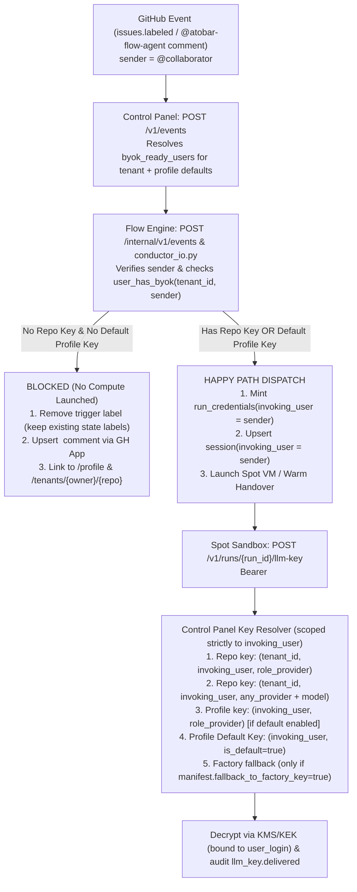

# J53 (user-byok-billing-and-profile-keys): Per-Invoking-User BYOK Billing, Profile-Level Default Keys, Collaborator Repo Keys & Unonboarded Trigger Gate

- **Priority:** P0 (Multi-Collaborator Billing Isolation & BYOK Onboarding UX)
- **Milestone:** M11 (Public Domain Release & Multi-User Governance)
- **Cross-Service Scope:** `contracts` ↔ `flow-engine` ↔ `control-panel` ↔ `atobar-ops` + 1 Supabase migration (`0027_user_byok_billing.sql`)

---

## 1. Goal & User Experience

Transition ATOBAR from **repository-shared BYOK keys** (`primary key (tenant_id, provider)`, where whichever admin saves a key last overwrites the single repo key and pays for every collaborator's runs) to **strict per-invoking-user BYOK billing** with a two-tier key hierarchy and a friendly GitHub App onboarding gate:

1. **Per-User Repository Keys (`/tenants/{owner}/{repo}`):**
   - Any authenticated repository collaborator with access to a tenant in the Control Panel can add, validate, replace, and delete **their own** BYOK API key(s) on that repository (`(tenant_id, user_login, provider)`).
   - One collaborator adding or deleting a key on `owner/repo` never overwrites, exposes, or deletes another collaborator's key on `owner/repo`.
2. **Profile-Level Keys & "Default Key" Setting (`/profile`):**
   - Every signed-in GitHub user has a **Profile & Default LLM Keys** page (`GET /profile`, linked in the Control Panel header and home dashboard) where they can manage personal profile-level API keys across providers (`gemini`, `claude`, `deepseek`, `grok`) and select a **Default Profile Key** (`is_default = true`, plus default model per key).
   - When a collaborator invokes a run on a repository where they have **not** configured a repository-specific key, ATOBAR automatically resolves and bills their **Default Profile Key**.
3. **Unonboarded Collaborator Trigger Gate (ATOBAR GitHub App Reply & Label Rollback):**
   - If a collaborator triggers an agent run (via issue labeling `flow:feature`, `flow:fix`, `flow:plan`, `flow:approved`, `flow:resume` or via an `@atobar-flow-agent` / `@atobar` / `/flow` comment on an Issue or PR) and has **neither** a repository key on that repo **nor** a Default Profile Key configured in ATOBAR:
     - ATOBAR **blocks the dispatch** before minting `run_credentials`, launching an EC2 Spot instance, or mutating existing issue state (`flow:needs-approval`, `flow:escalated`).
     - On label triggers, ATOBAR removes the applied trigger label so the issue can be cleanly re-triggered once the user onboards.
     - ATOBAR replies via the `atobar-flow-agent[bot]` GitHub App with a deduplicated comment (`<!-- atobar:byok-hold:{user_login} -->`) explaining that the action is not permitted because `@{sender}` has no BYOK key configured, and linking directly to `{cp_url}/profile` (to configure a Default Profile Key) and `{cp_url}/tenants/{owner}/{repo}` (to configure a repo-specific key).
4. **Happy-Path Per-User Lineage Across Multi-Turn Loops & Retries:**
   - When the invoking collaborator has a repo key or a Default Profile Key configured, ATOBAR records `invoking_user` (normalized lowercase GitHub login) on `run_credentials`, `sessions`, and `loop_rounds`, propagates `invoking_user` across all autonomous follow-up turns in that loop epoch (`planner` $\rightarrow$ `developer` $\rightarrow$ `evaluator` $\rightarrow$ rework $\rightarrow$ `arbitrator`, including warm Spot VM handovers and CI `check_run.completed` events), and unlocks **only** `invoking_user`'s key at `POST /v1/runs/{run_id}/llm-key`.

---

## 2. Forensic Audit of Current Codebase (`<how today>`)

| Area | Current Behavior & Location | Root-Cause Limitation |
| :--- | :--- | :--- |
| **1. `tenant_llm_keys` Schema** | `infra/supabase/migrations/0004_tenant_llm_keys.sql` defines `primary key (tenant_id, provider)` with `created_by text not null` and no `user_login` key column. | Saving a `gemini` key on `ollama-monitor` overwrites the single `gemini` row for that repo; all collaborators' runs share and bill that single key. |
| **2. Profile-Level Keys** | No `user_llm_keys` table and no `/profile` route in `control-panel/src/control_panel/web.py`. | Users must configure keys repo-by-repo as a repo admin; there is no user-level Default Key fallback across repositories. |
| **3. Repo UI Access Control** | `web.py:826,1610,2067` gates `_llm_section`, `POST /tenants/{owner}/{repo}/llm-keys`, and `DELETE` on `_managed_tenant()` (`session.can_manage`, i.e. GitHub `admin` only). | Non-admin collaborators with write/read access to a repository get `403 Forbidden` when trying to add their own BYOK key to a repository. |
| **4. Event Trigger Handling** | `flow-trigger.yml` sends `"sender": "${{ github.event.sender.login }}"` to `POST /v1/events` (`control-panel/src/control_panel/app.py:225-265`), which forwards to `flow-engine/src/flow_engine/api.py:895`. | `api.py` records `sender` only on `conductor_events`. It never checks whether `sender` has a BYOK key before removing stale labels, minting `run_credentials`, or launching Spot VMs, and never stores `invoking_user` on `run_credentials`, `sessions`, or `loop_rounds`. |
| **5. Key Delivery (`POST /v1/runs/{run_id}/llm-key`)** | `control-panel/src/control_panel/app.py:444-530` looks up `pref = store.role_llm_prefs(tenant.id)[role]` and calls `store.get_tenant_llm_key_record(tenant.id, provider)`. | Resolves purely by `(tenant.id, provider)` without `invoking_user`. Cannot distinguish which collaborator triggered the run or fall back to a user's Default Profile Key. |
| **6. Cryptographic Binding** | `control-panel/src/control_panel/llm_keys.py:150-245` binds AEAD AAD and KMS `EncryptionContext` only to `(tenant_id, provider)`. | Does not cryptographically bind user-scoped ciphertexts to `user_login` or support tenant-independent profile keys (`profile:{user_login}`). |

---

## 3. Architecture & Key Resolution Precedence

### 3.1 End-to-End Trigger & Key Resolution Flow

### 3.2 Key Architectural Decisions

| # | Decision Area | Chosen Design | Reasoning |
| :--- | :--- | :--- | :--- |
| **1** | **Single-Writer Boundary (`test_table_ownership.py`)** | Keep `tenant_llm_keys` and new `user_llm_keys` in `CP_OWNED_TABLES` (read/written **only** by `control-panel`). Keep `run_credentials`, `sessions`, and `loop_rounds` in `FE_OWNED_TABLES` (written **only** by `flow-engine`). `control-panel` attaches `byok_users: list[str]` (logins with a repo key on `tenant_id` or an active Default Profile Key) when forwarding `InternalEventRequest` to `flow-engine`. | Preserves the J36 CSPM security invariant where `flow-engine` never has Supabase table access to key `ciphertext`/`wrapped_dek`, while giving `flow-engine` and `conductor_io.py` deterministic knowledge of which GitHub logins are BYOK-ready (even when `conductor_io.py` resolves `verified_sender` from the GitHub Comment API). |
| **2** | **Single Profile Key Table (`public.user_llm_keys`)** | Store profile keys in `public.user_llm_keys (user_login, provider)` with `is_default boolean not null default false` and a partial unique index `unique (user_login) where is_default = true`. | Avoids a second profile-settings join table. A user can store keys for multiple providers on their profile while PostgreSQL enforces at most one `is_default = true` key per `user_login`. |
| **3** | **Provider/Model Reconciliation on Fallback** | When `invoking_user`'s resolved key (e.g. Default Profile Key `claude`) differs from the repository's `tenant_role_llm[role]` provider (e.g. `gemini`), resolve the model from the key row's `selected_model` (or `available_models[0]`) instead of pairing a `claude` key with `gemini-2.5-pro`. | Guarantees that a collaborator's Default Profile Key works out-of-the-box on any repository, even if the repository admin configured role preferences for a different LLM provider. |
| **4** | **Strict Non-Cross-Billing Invariant** | Once `invoking_user` is bound on `run_credentials`, `POST /v1/runs/{run_id}/llm-key` **never** falls back to another user's key on that tenant. Legacy `user_login = ''` rows are used only when `invoking_user` is unset (`None`/`""`). | Prevents accidental or malicious cross-user billing if a collaborator deletes their key mid-run or between rounds. |
| **5** | **Loop Lineage Propagation** | Human triggers (`issues.labeled`, `issues.edited`, `@atobar-flow-agent` comments, drained queued directives) set `invoking_user = verified_sender.lower()`. Autonomous continuations (`flow-plan`, `flow-ack`, `flow-verdict`, `check_run.completed`, `pull_request.synchronize`, warm VM handovers) inherit `invoking_user` from the triggering credential or latest current-epoch `loop_rounds`/`sessions` row. | Ensures all rounds of an issue loop (`planner` $\rightarrow$ `developer` $\rightarrow$ `evaluator`) are billed to the human who initiated or most recently steered/resumed the loop. |

---

## 4. Edge-Case & Corner-Case Matrix

| # | Edge Case | Required Deterministic Behavior |
| :--- | :--- | :--- |
| **EC-1** | **Unonboarded collaborator applies `flow:feature` / `flow:fix` / `flow:plan`** | Dispatch blocked; label `flow:*` removed via GitHub App; deduplicated comment (`<!-- atobar:byok-hold:{login} -->`) posted with links to `/profile` and `/tenants/{owner}/{repo}`; no `run_credentials` or `sessions` created. |
| **EC-2** | **Unonboarded collaborator applies `flow:approved` or `flow:resume` on an issue in `flow:needs-approval` or `flow:escalated`** | BYOK check runs **before** removing `stale_labels` or posting `LOOP_EPOCH_MARKER`. Only `flow:approved`/`flow:resume` is removed; `flow:needs-approval` / `flow:escalated` and current human assignee remain intact; onboarding hold comment posted. |
| **EC-3** | **Collaborator onboards key and re-applies the same label on the same issue** | Blocked label attempt does **not** poison `conductor_events` for future label applications (only deduplicates identical `X-GitHub-Delivery` webhook retries). Re-applying `flow:feature` after saving a repo or Default Profile Key dispatches immediately. |
| **EC-4** | **Webhook retry of a blocked trigger (`same X-GitHub-Delivery`)** | Deduplicated via `upsert_issue_comment_by_marker(..., BYOK_HOLD_MARKER_FOR_USER)` / `delivery_id`; never posts duplicate spam comments on the issue. |
| **EC-5** | **Unonboarded collaborator comments `@atobar-flow-agent ...` on an Issue or PR** | `conductor_io.py` verifies `verified_sender` via GitHub API, sees `verified_sender` is not BYOK-ready, posts the BYOK onboarding comment on the Issue/PR, does **not** queue or dispatch a turn, and records the comment dedup key so retries do not re-comment. |
| **EC-6** | **Collaborator deletes their key while a run / multi-turn loop is in flight** | Next `POST /v1/runs/{run_id}/llm-key` call for `invoking_user` returns `404 No LLM key configured for invoking user @{login}`. It **never** falls back to another collaborator's or admin's key on the same repo. |
| **EC-7** | **Two collaborators (`@alice`, `@bob`) save keys for the same provider on the same repo** | Stored as distinct rows `(tenant_id, 'alice', 'gemini')` and `(tenant_id, 'bob', 'gemini')`. `@bob` cannot view or delete `@alice`'s key; `@alice`'s runs use `@alice`'s key and `@bob`'s runs use `@bob`'s key. |
| **EC-8** | **Collaborator has both a Repo Key and a Default Profile Key** | Repo Key on `tenant_id` for `invoking_user` strictly takes precedence over `invoking_user`'s Default Profile Key. Deleting the Repo Key seamlessly falls back to the Default Profile Key on subsequent runs. |
| **EC-9** | **Repo `tenant_role_llm` uses `gemini`, but `@bob` only has a `claude` Default Profile Key** | `POST /v1/runs/{run_id}/llm-key` selects `@bob`'s `claude` Default Profile Key and pairs it with `@bob`'s validated `claude` `selected_model` (or `available_models[0]`) instead of returning `gemini`'s model name. |
| **EC-10** | **Second collaborator (`@bob`) steers or approves an issue originally started by `@alice`** | When `@bob` (who has BYOK configured) applies `flow:approved` / `flow:resume` or comments `@atobar-flow-agent <correction>`, the newly dispatched turn and its subsequent verification turns update `invoking_user = "bob"`. |
| **EC-11** | **Queued directive (`<!-- flow:queued-directive:... -->`) drained after active turn finishes** | Queued directive marker encodes the verified commenter login (`<!-- flow:queued-directive:{cid}:{target}:{intent}:{sender} -->`); when drained on convergence, the follow-up turn is dispatched with `invoking_user = sender`. |
| **EC-12** | **Case-insensitive GitHub logins & Legacy pre-migration keys** | `ArsenySPB` and `arsenyspb` normalize to `arsenyspb` everywhere. Existing `tenant_llm_keys` rows migrated with `kek_version in (1, 2)` (sealed under legacy `(tenant_id, provider)` AAD) continue to decrypt cleanly while all newly saved keys bind `user_login` in AEAD AAD and KMS `EncryptionContext`. |

---

## 5. Work Packages

### WP-1: Supabase Migration (`0027_user_byok_billing.sql`), Cryptographic Binding & Store Layer (`infra/supabase`, `contracts`, `control-panel`, `flow-engine`)
- **Files:**
  - `infra/supabase/migrations/0027_user_byok_billing.sql`
  - `control-panel/src/control_panel/llm_keys.py`
  - `contracts/src/atobar_contracts/store.py`, `contracts/src/atobar_contracts/api.py`
  - `control-panel/src/control_panel/store.py`, `flow-engine/src/flow_engine/store.py`
  - `tests/test_table_ownership.py`, `tests/test_boundaries.py`
- **Changes:**
  1. **Migration `0027_user_byok_billing.sql`:**
     - Alter `public.tenant_llm_keys`: add `user_login text not null default ''`, backfill `user_login = lower(trim(created_by))` where `user_login = ''`, replace PK `(tenant_id, provider)` with `primary key (tenant_id, user_login, provider)`, and add index on `(user_login)`.
     - Create `public.user_llm_keys`:
       - Columns: `user_login text not null`, `provider text not null`, `ciphertext text not null`, `wrapped_dek text`, `kek_version integer not null default 1`, `kms_key_id text`, `encryption_mode text not null default 'local_kek'`, `key_last4 text not null`, `available_models jsonb`, `selected_model text`, `is_default boolean not null default false`, `validated_at timestamptz not null`, `updated_at timestamptz not null default now()`.
       - Primary key `(user_login, provider)` and partial unique index `user_llm_keys_single_default_idx on public.user_llm_keys (user_login) where is_default = true`.
       - Enable RLS and grant `select, insert, update, delete` to `service_role`.
     - Alter `public.run_credentials`, `public.sessions`, and `public.loop_rounds`: add `invoking_user text`.
  2. **Envelope Encryption (`control-panel/src/control_panel/llm_keys.py`):**
     - Extend `seal_llm_key` and `open_llm_key` (plus `encrypt`/`decrypt`) with optional `user_login: Optional[str] = None` and `scope: Literal["tenant", "profile"] = "tenant"`.
     - When `scope == "profile"`, bind AAD / KMS `EncryptionContext` to `("profile:" + user_login.lower(), provider)`.
     - When `scope == "tenant"` and `user_login` is provided, bind AAD / KMS `EncryptionContext` to `(tenant_id, user_login.lower(), provider)`, with fallback in `open_llm_key` to legacy `(tenant_id, provider)` AAD for pre-migration rows so migrated keys continue to open without re-entry.
  3. **Store Protocol & Implementations (`SupabaseStore` & `MemoryStore`):**
     - Update `llm_keys(tenant_id, *, user_login: Optional[str] = None)`, `put_llm_key(tenant_id, provider, row, *, user_login: Optional[str] = None)`, `delete_llm_key(tenant_id, provider, *, user_login: Optional[str] = None)`, `get_tenant_llm_key_record(tenant_id, provider, *, user_login: Optional[str] = None)`, and `get_tenant_llm_ciphertext(tenant_id, provider, *, user_login: Optional[str] = None)`.
     - Add profile key methods: `user_llm_keys(user_login: str) -> list[dict[str, Any]]`, `put_user_llm_key(user_login: str, provider: str, row: dict[str, Any]) -> None`, `delete_user_llm_key(user_login: str, provider: str) -> None`, `set_user_default_llm_key(user_login: str, provider: Optional[str], *, selected_model: Optional[str] = None) -> None`, `get_user_llm_key_record(user_login: str, provider: Optional[str] = None) -> Optional[dict[str, Any]]`, and `user_has_byok(tenant_id: str, user_login: str) -> bool` / `byok_ready_users_for_tenant(tenant_id: str) -> list[str]`.
     - Add `invoking_user: Optional[str] = None` to `create_run_credential` and propagate to `sessions` and `loop_rounds`.
     - Register `"user_llm_keys"` in `CP_OWNED_TABLES` (`tests/test_table_ownership.py`) and register new `MemoryStore` getters/writers in `tests/test_boundaries.py`.
- **Acceptance Criteria:**
  - [ ] **AC-1:** Migration `0027_user_byok_billing.sql` is idempotent, backfills `user_login = lower(created_by)` on existing `tenant_llm_keys` rows, and enforces `primary key (tenant_id, user_login, provider)` plus `user_llm_keys_single_default_idx`.
  - [ ] **AC-2:** Ciphertexts sealed for `(tenant_id, "alice", "gemini")` cannot be decrypted as `(tenant_id, "bob", "gemini")` or as a profile key, while pre-migration `(tenant_id, "gemini")` rows still decrypt for their `created_by` owner.
  - [ ] **AC-3:** `test_table_ownership.py` and `test_boundaries.py` (including deep-copy checks on all new `MemoryStore` getters) pass.

### WP-2: Control Panel Profile Keys (`/profile`) & Collaborator Repo Keys (`/tenants/{owner}/{repo}`) (`control-panel`)
- **Files:**
  - `control-panel/src/control_panel/web.py`
  - `control-panel/tests/test_web.py`
- **Changes:**
  1. **Header & Home Navigation:**
     - Add a `Profile & Default Keys (`/profile`)` link in `_page()` header next to `{session.login}` and a BYOK status indicator on the `/` home page showing whether the signed-in user has a Default Profile Key configured.
  2. **Profile Page (`GET /profile`, `POST /profile/llm-keys`, `POST /profile/llm-keys/{provider}/delete`, `POST /profile/default-key`):**
     - Allow any signed-in user to validate and save personal API keys per provider (`gemini`, `claude`, `deepseek`, `grok`), select a default model per key from `available_models`, and choose which provider key is their **Default Profile Key** (auto-selecting the first key added if none is default yet, and allowing switching or clearing the default).
     - All POST routes enforce `_same_origin` + `verify_csrf`; `GET` on action paths redirects to `/profile` (or `/login?next=%2Fprofile` when unauthenticated).
  3. **Collaborator-Scoped Repository Keys on `/tenants/{owner}/{repo}`:**
     - Allow any authenticated user with repository access (`session.can_see(full)`) to view the **Your Repository LLM Keys** card on `/tenants/{owner}/{repo}`, add/replace **their own** key (`POST /tenants/{owner}/{repo}/llm-keys` with `user_login = session.login.lower()`), and delete **their own** key (`POST /tenants/{owner}/{repo}/llm-keys/{provider}/delete`).
     - Display whether the user currently has a repo-specific key active on `{owner}/{repo}` or is inheriting their Default Profile Key from `/profile`.
     - Keep repository-wide admin controls (`Model per role` `tenant_role_llm`, `Tenant API token`, `Arbitration mode`, `Loop Policy & Budget Caps`, `Repository Metrics`, `Goal`, `SotaWiki` cadence/regenerate) strictly gated on `session.can_manage(full)`.
     - Update `_is_llm_ready(store, tenant_id, user_login=session.login)` and `_model_choices` so repo admins can pick role models from validated keys on the tenant or their Default Profile Key.
- **Acceptance Criteria:**
  - [ ] **AC-4:** Any signed-in user can add/delete profile-level keys on `/profile` and select a Default Profile Key + default model; CSRF and unauthenticated redirect guards are enforced on all `/profile/*` routes.
  - [ ] **AC-5:** Two collaborators (`alice` and `bob`) on the same repository can each save and delete their own `gemini` key on `/tenants/{owner}/{repo}/llm-keys` without overwriting or seeing each other's ciphertext, while non-admins still receive `403` on admin-only routes (`/token`, `/arbitration-mode`, `/llm-roles/*`, `/guardrails`).

### WP-3: Trigger-Time BYOK Gate, Label Rollback & ATOBAR GitHub App Onboarding Reply (`contracts`, `control-panel`, `flow-engine`)
- **Files:**
  - `contracts/src/atobar_contracts/issue_states.py`, `contracts/src/atobar_contracts/api.py`, `contracts/src/atobar_contracts/conductor_io.py`
  - `control-panel/src/control_panel/app.py`, `control-panel/src/control_panel/flow_engine_client.py`
  - `flow-engine/src/flow_engine/api.py`
- **Changes:**
  1. **Onboarding Hold Comment Renderer (`contracts/src/atobar_contracts/issue_states.py`):**
     - Add `BYOK_HOLD_MARKER = "<!-- atobar:byok-hold -->"`, `byok_hold_marker_for(user_login: str) -> str`, and `render_byok_onboarding_required_comment(repo: str, sender: str, trigger: str, cp_url: str = "") -> str` (resolving `cp_url` via `resolve_cp_url(cp_url)` composed from `CP_PUBLIC_URL` / `https://$CP_HOSTNAME`).
     - The comment clearly states that triggering `{trigger}` is not permitted because `@{sender}` does not have a repository BYOK key on `{repo}` or a Default Profile Key in ATOBAR, and provides clickable onboarding links to `{cp_url}/profile` and `{cp_url}/tenants/{repo}`.
  2. **Gateway BYOK Context Enrichment (`control-panel/src/control_panel/app.py`):**
     - In `ingest_event()`, compute `byok_users = store.byok_ready_users_for_tenant(tenant.id)` (plus `sender_has_byok = store.user_has_byok(tenant.id, event.sender)` when `event.sender` is present) and include it on `InternalEventRequest` forwarded to `flow-engine`.
  3. **Issue Label Trigger Gate (`flow-engine/src/flow_engine/api.py` & `control-panel/src/control_panel/flow_engine_client.py`):**
     - On `issues.labeled` / `issues.edited` for agent trigger labels (`flow:feature`, `flow:fix`, `flow:plan`, `flow:approved`, `flow:resume`):
       - Resolve `sender_login = (inner_event.get("sender") or "").strip().lower()` (and if `gh` provides `get_latest_label_actor`, prefer the GitHub-verified label actor).
       - **Before** removing `stale_labels`, unassigning `human_login`, posting `LOOP_EPOCH_MARKER`, or minting `run_credentials`, check whether `sender_login` has BYOK configured (via `sender_has_byok` / `byok_users` / `store.user_has_byok(tenant.id, sender_login)` or `fallback_to_factory_key`).
       - If `sender_login` is present and lacks BYOK:
         - Call `gh.remove_label(tenant.repo, issue_num, label)` (removing only the newly applied trigger label).
         - Call `upsert_issue_comment_by_marker(gh, tenant.repo, issue_num, byok_hold_marker_for(sender_login), comment_body)`.
         - Record security audit / run event `byok.trigger_blocked` and return `{"status": "blocked", "dispatched": False, "reason": f"user {sender_login} has no BYOK key configured"}` without poisoning future re-labels after onboarding.
  4. **Conversational Directive Gate (`contracts/src/atobar_contracts/conductor_io.py`):**
     - In `process_flow_event()`, when a trusted human comments `@atobar-flow-agent ...` / `@atobar ...` / `/flow ...`, verify that `verified_sender` has BYOK configured before queueing or dispatching `HumanCommentEvent`.
     - If `verified_sender` lacks BYOK, upsert the `render_byok_onboarding_required_comment` on `source_pr_number or pr_number`, mark the comment event processed (for webhook retry idempotency), and return `{"status": "blocked", "dispatched": False, "reason": f"user {verified_sender} has no BYOK key configured"}`.
- **Acceptance Criteria:**
  - [ ] **AC-6:** When an unonboarded collaborator applies `flow:feature`, `flow:fix`, `flow:plan`, `flow:approved`, or `flow:resume`, no Spot instance or run credential is created, the trigger label is removed (while preserving existing `flow:needs-approval` / `flow:escalated` state labels), and ATOBAR's GitHub App posts the onboarding required comment.
  - [ ] **AC-7:** When that collaborator subsequently adds a repository key or Default Profile Key and re-applies the label on the same issue, the run dispatches on the happy path.
  - [ ] **AC-8:** When an unonboarded collaborator comments `@atobar-flow-agent ...` on an Issue or PR, ATOBAR replies with the BYOK onboarding comment and does not queue or dispatch a turn.

### WP-4: Per-User Lineage (`invoking_user`) & Deterministic Key Delivery Precedence (`control-panel`, `flow-engine`, `contracts`)
- **Files:**
  - `control-panel/src/control_panel/app.py`
  - `flow-engine/src/flow_engine/api.py`
  - `contracts/src/atobar_contracts/conductor_io.py`
  - `control-panel/src/control_panel/flow_engine_client.py`
- **Changes:**
  1. **Persist & Propagate `invoking_user`:**
     - On initial label dispatch (`api.py`), pass `invoking_user=sender_login` to `store.create_run_credential(...)` and `store.upsert_session(...)`.
     - In `conductor_io.py:process_flow_event()` and `apply_actions()`:
       - Resolve `invoking_user` for the turn:
         - For `HumanCommentEvent` / `HumanLabelEvent`: `verified_sender.lower()` (or drained queued directive's sender).
         - For autonomous envelope/CI/push events (`PlanEvent`, `AckEvent`, `VerdictEvent`, `CheckCompletedEvent`, `PushEvent`): inherit `invoking_user` from the authenticated/envelope `cred_record.get("invoking_user")` or the latest current-epoch `loop_rounds`/`sessions` row for `(tenant.id, pr_number)`.
       - Store `invoking_user` on every recorded `loop_rounds` row, newly minted `run_credentials` row (including warm handovers), and `sessions` row.
     - Encode `verified_sender.lower()` into queued directive markers (`<!-- flow:queued-directive:{cid}:{target}:{intent}:{sender} -->`) while keeping backward compatibility with 3-field markers.
  2. **Key & Model Precedence in `POST /v1/runs/{run_id}/llm-key` (`control-panel/src/control_panel/app.py`):**
     - Read `invoking_user = (record.get("invoking_user") or "").strip().lower()`.
     - When `invoking_user` is set, resolve exclusively from `invoking_user`'s keys:
       1. `store.get_tenant_llm_key_record(tenant.id, preferred_provider, user_login=invoking_user)`
       2. Any other repo key owned by `invoking_user` on `tenant.id` (pairing with that key's `selected_model` or `available_models[0]`)
       3. `invoking_user`'s profile key for `preferred_provider` (when `invoking_user` has a Default Profile Key enabled)
       4. `invoking_user`'s Default Profile Key (`store.get_user_llm_key_record(invoking_user)`, pairing with `preferred_model` if same provider, else `selected_model` or `available_models[0]`).
     - Audit `invoking_user` and `key_source` (`"repo_user"` | `"profile_default"` | `"legacy_tenant"` | `"factory_fallback"`) in `security_audit_log` (`llm_key.delivered`).
     - Render `invoking_user` in `GET /tenants/{owner}/{repo}/prs/{pr_number}` round timeline table.
- **Acceptance Criteria:**
  - [ ] **AC-9:** `POST /v1/runs/{run_id}/llm-key` delivers `invoking_user`'s repo key when present, falls back to `invoking_user`'s Default Profile Key when no repo key is set, reconciles provider/model when the Default Profile Key uses a different provider than `tenant_role_llm`, and **never** delivers another user's key if `invoking_user`'s key is deleted mid-run.
  - [ ] **AC-10:** Across a multi-turn loop (`planner` $\rightarrow$ warm handover `developer` $\rightarrow$ CI `check_run.completed` $\rightarrow$ `evaluator` $\rightarrow$ rework `developer`), `invoking_user` is preserved on every `run_credentials`, `sessions`, and `loop_rounds` row, and updates to `@bob` if `@bob` steers the PR via `@atobar-flow-agent`.

### WP-5: Isolation, Retry & Edge-Case Verification Suite + `atobar-ops db tenant` CLI (`tests`, `atobar-ops`)
- **Files:**
  - `control-panel/tests/test_user_byok_billing.py` (new comprehensive suite)
  - `control-panel/tests/test_web.py`, `control-panel/tests/test_key_delivery.py`, `control-panel/tests/test_j09_trigger_hygiene.py`
  - `flow-engine/tests/conductor/test_loop_round_usage.py`
  - `atobar-ops/src/atobar_ops/db.py`, `atobar-ops/src/atobar_ops/cli.py`
- **Changes:**
  - Add dedicated test suite `control-panel/tests/test_user_byok_billing.py` covering `EC-1` through `EC-12` (multi-user repo key isolation, profile default key fallback, provider/model reconciliation, unonboarded label trigger block + label removal + onboarding comment, webhook retry dedup, re-label after onboarding happy path, unonboarded `@atobar-flow-agent` comment block, mid-run key deletion fail-closed 404, warm handover & CI check_run `invoking_user` inheritance, second-collaborator PR steering billing switch, and legacy key migration compatibility).
  - Update `atobar-ops db tenant <owner/repo>` to display per-user repo keys (`user_login`, `provider`, `key_last4`) alongside role model configuration.
- **Acceptance Criteria:**
  - [ ] **AC-11:** All 12 edge cases (`EC-1`..`EC-12`) have deterministic unit/integration tests with zero sleeps or live network calls.
  - [ ] **AC-12:** `uv run --no-sync atobar-ops verify` passes 100% (`ruff`, combined `mypy`, root `pytest -q`, schemas, `gitleaks`).
