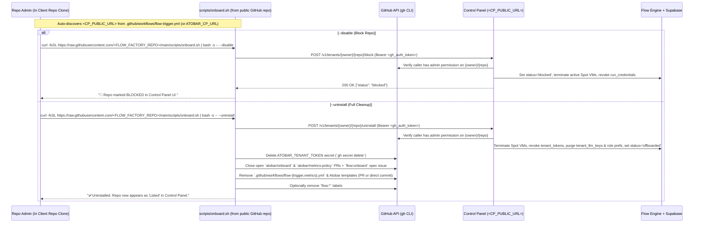

# J54 (domain-neutrality-and-repo-lifecycle-ux): Domain-Neutral Configuration Rule, Public-Repo `onboard.sh` Delivery, 3-State Repository UX (`Listed` / `Ready` / `Blocked`), and 1-Line Uninstall/Cleanup

- **Priority:** P0 (Open-Source Generalization, Abuse Prevention & Clean Offboarding)
- **Milestone:** M11 (Public Domain Release & User-Zero Self-Hosting)
- **Target Repo:** `https://github.com/atobar-flow/atobar-flow`
- **E2E Verification Target:** `arsenyspb/ollama-monitor` (full cycle: `--uninstall` cleanup -> re-onboard to `Ready` -> `--disable` `Blocked` trigger rejection -> `--enable` back to `Ready`)

---

## 1. Problem Statement & Core Use Cases

Today, onboarding a repository to Atobar Flow has four gaps:
1. **Domain-Neutrality Rule Needed:** Source code, `.env.sample`, Terraform defaults, and docs (`AI.md`, `AGENTS.md`, `docs/*.md`, `README.md`) must never hardcode any specific deployment's Control Panel domain. The Control Panel URL (`CP_PUBLIC_URL` / `CP_HOSTNAME`) and Factory Repository (`FLOW_FACTORY_REPO`) are strictly deployment-instance variables supplied via `.env` / runtime environment.
2. **Public-Repo `scripts/onboard.sh` Delivery (Off the Control Panel):** The install/lifecycle script (`scripts/onboard.sh`) must be fetched directly from the public repository or fork of Atobar Flow itself (`https://raw.githubusercontent.com/<FLOW_FACTORY_REPO>/main/scripts/onboard.sh`), not hosted off `<CP_PUBLIC_URL>/onboard.sh`.
3. **No UI or CLI Kill-Switch (`Blocked`) or Client-Repo Feedback:** Once `.github/workflows/flow-trigger.yml` and `ATOBAR_TENANT_TOKEN` exist in a client repository, if a collaborator is downgraded or an admin wants to immediately block all Atobar executions while keeping the GitHub App installed, there is no UI button or CLI command (`--disable`) to block the repo, nor does Atobar post a visible comment back into the client repository explaining why a trigger was ignored.
4. **No 1-Line Uninstall (`onboard.sh --uninstall`) & Ambiguous UI States:** Removing Atobar Flow from a client repository requires manual deletion of workflows, templates, `ATOBAR_TENANT_TOKEN` secrets, and DB tokens/keys, and the Control Panel UI does not clearly distinguish between **`Listed`**, **`Ready`**, and **`Blocked`** repositories.

---

## 2. Architectural Principles

### 2.1 The Domain-Neutrality Rule (`AI.md`, `AGENTS.md`, `docs/AGENTS.md`, `tests/test_boundaries.py`)
- Source code, Terraform defaults, `.env.sample`, and documentation (`AI.md`, `AGENTS.md`, `docs/*.md`, `README.md`) **must never hardcode any deployment-specific Control Panel domain**.
- `.env.sample`, docs, and tests use only RFC 2606 reserved example domains (`cp.example.com` / `https://cp.example.com`) or variable placeholders (`<CP_PUBLIC_URL>`, `<CP_HOSTNAME>`, `<FLOW_FACTORY_REPO>`).
- Any operator's live domain lives exclusively in their local gitignored `.env` and HCP Terraform workspace variables.

### 2.2 Public-Repo Script Delivery (`scripts/onboard.sh` from `<FLOW_FACTORY_REPO>`)
- Remove `GET /onboard.sh` from the Control Panel API.
- The canonical script is invoked from the public factory repository or fork:
  ```text
  https://raw.githubusercontent.com/<FLOW_FACTORY_REPO>/main/scripts/onboard.sh
  ```
- **How `scripts/onboard.sh` resolves `CP_URL`:**
  1. Explicit flag `--cp-url <url>` or env var `ATOBAR_CP_URL=<url>` (rendered automatically in the Control Panel UI's copy-paste snippets using the server's configured `CP_PUBLIC_URL` and `FLOW_FACTORY_REPO`).
  2. **Auto-discovery from `.github/workflows/flow-trigger.yml`:** When `.github/workflows/flow-trigger.yml` already exists in the client repo clone (always true for `--disable`, `--enable`, `--uninstall`, or re-runs), `scripts/onboard.sh` extracts `<CP_URL>` directly from the `/v1/events` URL in `flow-trigger.yml`.
  3. Interactive prompt if neither (1) nor (2) is present during initial onboarding.

---

## 3. The 3 Canonical Repository States (`Listed` | `Ready` | `Blocked`)

```mermaid
stateDiagram-v2
    [*] --> Listed: GitHub App installed on repo
    Listed --> Onboarding: Admin clicks "Add" or runs onboard.sh
    Onboarding --> Ready: Token saved + BYOK LLM keys + Metric calibrated
    Onboarding --> Blocked: Admin clicks "Block" or runs onboard.sh --disable
    Ready --> Blocked: Admin clicks "Block" or runs onboard.sh --disable\n(terminates active Spot VMs, rejects triggers w/ comment)
    Blocked --> Ready: Admin clicks "Unblock" or runs onboard.sh --enable\n(if readiness checks pass)
    Blocked --> Onboarding: Admin clicks "Unblock" (if setup incomplete)
    Blocked --> Listed: Admin runs onboard.sh --uninstall\n(removes workflows, secret, tokens & keys; keeps App installed)
    Ready --> Listed: Admin runs onboard.sh --uninstall
```



| UI Badge | Internal State | Meaning | Runtime Behavior on Trigger (`flow:*` label or `@atobar-flow-agent` comment) |
| :--- | :--- | :--- | :--- |
| **`Listed`** (Grey pill) | App installed on GitHub, not registered in `tenants` (or `offboarded` after `--uninstall`) | The GitHub App is installed on the repository and has valid permissions, but the repository is not active in Atobar Flow. | No active `ATOBAR_TENANT_TOKEN`; `POST /v1/events` returns `401`. UI shows **`Add to atobar-flow`** action. |
| **`Onboarding`** (Amber pill) | `tenants.status = 'onboarding'` | Registered in Control Panel; awaiting token, BYOK key, or initial metric calibration. | Removes applied `flow:*` work label and upserts the deduplicated `<!-- flow-onboarding-hold -->` checklist comment. |
| **`Ready`** (Green pill) | `tenants.status = 'active'` | Fully onboarded: `ATOBAR_TENANT_TOKEN` secret stored, KMS-encrypted BYOK keys + role models valid, and $\ge 1$ metric calibrated. | Dispatches `PLANNER`, `DEVELOPER`, `EVALUATOR`, `ARBITRATOR` on EC2 Spot. |
| **`Blocked`** (Red pill `🚫 Blocked`) | `tenants.status = 'blocked'` | Explicitly disabled by a repo admin via UI or CLI (`onboard.sh --disable`) while keeping the GitHub App installed. | **Hard Kill-Switch:** Terminates any running Spot VMs on entry; ignores all triggers (`flow:*` labels, `@atobar-flow-agent` comments), removes the applied `flow:*` label, and posts a deduplicated `<!-- flow-repo-blocked -->` comment on the client Issue/PR. |

---

## 4. Two-Pronged Lifecycle & Uninstall Design

### Prong 1 — Control Panel UI & Runtime Block Gate

1. **Unified Repository Directory on `GET /` (`Listed` / `Onboarding` / `Ready` / `Blocked`):**
   - Displays all repositories where the GitHub App is installed and the user has access, clearly badged as **`Listed`**, **`Onboarding`**, **`Ready`**, or **`Blocked`**.
2. **Admin Governance & Uninstall Card on `GET /tenants/{owner}/{repo}`:**
   - **Block / Unblock Toggle (`POST /tenants/{owner}/{repo}/block` & `/unblock`):**
     - **Block:** Sets `tenants.status = 'blocked'`, terminates any running/pending EC2 Spot instances for that tenant, revokes active `run_credentials`, and records an audit event.
     - **Unblock:** Re-evaluates readiness (`_is_llm_ready` + calibrated metrics) and transitions back to `Ready` (`active`) or `Onboarding`.
   - **Dynamic Copy-Paste CLI Commands (rendered from server `cfg.factory_repo` and `cfg.public_url`):**
     - **Onboard:**
       ```bash
       curl -fsSL https://raw.githubusercontent.com/<FLOW_FACTORY_REPO>/main/scripts/onboard.sh | ATOBAR_CP_URL=<CP_PUBLIC_URL> bash
       ```
     - **Disable / Block from clone (auto-detects `CP_URL` from `flow-trigger.yml`):**
       ```bash
       curl -fsSL https://raw.githubusercontent.com/<FLOW_FACTORY_REPO>/main/scripts/onboard.sh | bash -s -- --disable
       ```
     - **Re-enable / Unblock from clone:**
       ```bash
       curl -fsSL https://raw.githubusercontent.com/<FLOW_FACTORY_REPO>/main/scripts/onboard.sh | bash -s -- --enable
       ```
     - **Full Uninstall / Cleanup from clone:**
       ```bash
       curl -fsSL https://raw.githubusercontent.com/<FLOW_FACTORY_REPO>/main/scripts/onboard.sh | bash -s -- --uninstall
       ```
3. **Client-Repo Feedback When `Blocked`:**
   - When `tenant.status == 'blocked'`, `POST /v1/events` returns `200 OK` (`{"status": "blocked", "dispatched": False}`), removes any newly applied `flow:*` trigger label, and upserts a single deduplicated comment (`<!-- flow-repo-blocked -->`) on the client Issue/PR explaining that executions are disabled for the repository and how a repo admin can re-enable or uninstall.

---

### Prong 2 — `scripts/onboard.sh` (`--disable`, `--enable`, `--uninstall`) & Admin CLI API



---

## 5. Work Packages (`WP-1`..`WP-5`)

- [ ] **WP-1: Domain-Neutrality Rule & Ratchet (`AI.md`, `AGENTS.md`, `docs/`, `.env.sample`, `tests/test_boundaries.py`)**
  - Codify the **Domain-Neutrality Rule** in `AI.md`, `AGENTS.md`, and `docs/AGENTS.md` without naming any deployment domain.
  - Replace all hardcoded domain defaults in `.env.sample`, `contracts/`, `control-panel/`, `flow-engine/`, `atobar-ops/`, `infra/terraform/`, `scripts/onboard.sh`, and `docs/` with neutral placeholders (`cp.example.com` / `https://cp.example.com` or required env vars), keeping the live domain only in local gitignored `.env` and HCP Terraform workspace vars.
  - Remove `GET /onboard.sh` from `control-panel/src/control_panel/app.py` and point all onboarding script URLs to `https://raw.githubusercontent.com/${FLOW_FACTORY_REPO}/main/scripts/onboard.sh`.
  - Remove the legacy `GITHUB_APP_INSTALLATION_ID` requirement from `.env.sample`, `control-panel/src/control_panel/github.py`, and `flow-engine/src/flow_engine/api.py` (using dynamic `GET /repos/{repo}/installation` everywhere).
  - Add the domain-neutrality ratchet to `tests/test_boundaries.py`.

- [ ] **WP-2: Schema & Runtime Kill-Switch (`Blocked` / `Offboarded` + Client-Repo Blocked Comment)**
  - Add migration `0027_tenant_blocked_status.sql` (`status in ('onboarding','active','blocked','paused','offboarded')`).
  - Add `BLOCKED_REPO_MARKER = "<!-- flow-repo-blocked -->"` and `render_repo_blocked_comment(...)` in `contracts/src/atobar_contracts/issue_states.py`.
  - Enforce the kill-switch in `flow-engine/src/flow_engine/api.py` and `control-panel/src/control_panel/app.py`: reject `/v1/runs/{run_id}/*` (`403`) when blocked, terminate active Spot instances on transition to `blocked`/`offboarded`, remove applied `flow:*` labels, and upsert the `<!-- flow-repo-blocked -->` comment on human-triggered issue/PR events.

- [ ] **WP-3: Control Panel UI 3-State Directory (`Listed` / `Ready` / `Blocked`) & Admin Lifecycle Endpoints**
  - Update `GET /` and `GET /tenants/{owner}/{repo}` in `control-panel/src/control_panel/web.py` to render `Listed`, `Onboarding`, `Ready`, and `Blocked` badges, the **Block / Unblock** buttons, and the dynamic `raw.githubusercontent.com/<FLOW_FACTORY_REPO>/main/scripts/onboard.sh` commands.
  - Add `POST /v1/tenants/{owner}/{repo}/{block,unblock,uninstall}` authenticated via the caller's GitHub token (`admin: true` on `{owner}/{repo}`).

- [ ] **WP-4: `scripts/onboard.sh` (`--disable`, `--enable`, `--uninstall` / `--cleanup` + Auto-Discovery of `CP_URL`)**
  - Update `scripts/onboard.sh` so it:
    1. Auto-discovers `CP_URL` from `.github/workflows/flow-trigger.yml` when present, or reads `ATOBAR_CP_URL` / `--cp-url`.
    2. Implements `--disable` (blocks repo in CP), `--enable` (unblocks repo in CP), and `--uninstall` / `--cleanup` (calls `/uninstall` to wipe tokens & stale `InvalidTag` LLM keys, deletes `ATOBAR_TENANT_TOKEN` secret, closes onboarding PRs/issues, removes workflow/template files, and returns repo to **`Listed`**).

- [ ] **WP-5: Unit Tests & Live E2E Verification on `arsenyspb/ollama-monitor`**
  - Full unit test suite + live verification on `arsenyspb/ollama-monitor`:
    1. Run `scripts/onboard.sh --uninstall` on `arsenyspb/ollama-monitor` to clean up legacy workflows, secrets, and unreadable `InvalidTag` LLM keys $\rightarrow$ verify `ollama-monitor` shows as **`Listed`**.
    2. Re-onboard `arsenyspb/ollama-monitor` with `scripts/onboard.sh` $\rightarrow$ verify **`Ready`**.
    3. Run `scripts/onboard.sh --disable` $\rightarrow$ verify **`Blocked`** in UI and verify that applying `flow:feature` on a test issue removes the label and posts the `<!-- flow-repo-blocked -->` comment without launching Spot compute.
    4. Run `scripts/onboard.sh --enable` $\rightarrow$ verify restoration to **`Ready`**.

---

## Acceptance Criteria

- [ ] **AC-1:** `AI.md`, `AGENTS.md`, `docs/*.md`, `.env.sample`, and runtime source files contain zero deployment-specific Control Panel domain literals (enforced by `tests/test_boundaries.py`), and `GITHUB_APP_INSTALLATION_ID` is no longer required.
- [ ] **AC-2:** `scripts/onboard.sh` is served from `https://raw.githubusercontent.com/<FLOW_FACTORY_REPO>/main/scripts/onboard.sh`, auto-discovers `CP_URL` from `.github/workflows/flow-trigger.yml` on existing clones, and supports `--disable`, `--enable`, and `--uninstall` (`--cleanup`).
- [ ] **AC-3:** Control Panel UI (`GET /` and `GET /tenants/{owner}/{repo}`) visually distinguishes **`Listed`**, **`Onboarding`**, **`Ready`**, and **`Blocked`** repositories and exposes UI + API controls (`block`, `unblock`, `uninstall`).
- [ ] **AC-4:** Triggering `flow:*` labels or `@atobar-flow-agent` comments on a **`Blocked`** repository never dispatches Spot compute, removes the applied `flow:*` label, and upserts the deduplicated `<!-- flow-repo-blocked -->` notice in the client repository.
- [ ] **AC-5:** Live E2E `--uninstall` $\rightarrow$ re-onboard (`Ready`) $\rightarrow$ `--disable` (`Blocked`) $\rightarrow$ `--enable` (`Ready`) cycle verified on `arsenyspb/ollama-monitor`, and `uv run --no-sync atobar-ops verify` passes with 0 errors.
